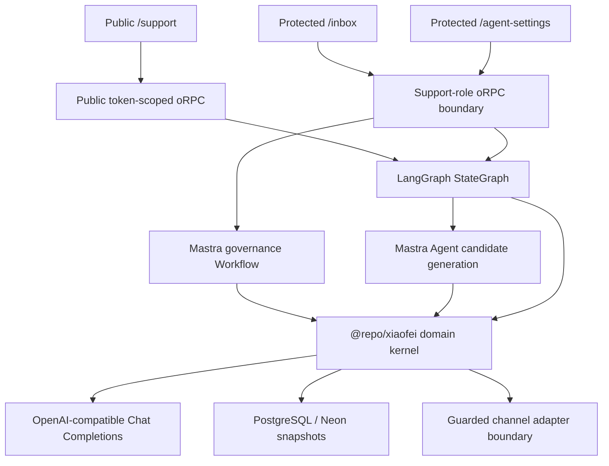

# Xiaofei

Xiaofei is an Agent control plane built on the supastarter Next.js monorepo. The
current P0 slice proves a controlled customer-service Agent: tenant-owned
configuration, structured Knowledge Units, stateful conversations, guarded
model output, deterministic evaluation, human handoff, and business-readable
traces.

This branch intentionally provides a complete framework with a small product
surface. It is ready for architecture and workflow validation, but it is not a
production-complete Agent Center.

## What works in P0

- configure Agent instructions, follow-up limits, and a Markdown knowledge
  source from a dedicated settings page;
- parse each Markdown section into a governed `KnowledgeUnit`;
- derive a reviewable capability plan with callable KU IDs, scenario boundaries,
  required-field matrices, and Eval suggestions;
- run a LangGraph state graph as the canonical conversation orchestrator;
- call a Mastra Agent only when the graph needs a model-generated candidate
  reply, and run a separate Mastra governance Workflow on configuration save;
- persist tenant snapshots, conversation state, and trace events in PostgreSQL
  or Neon;
- prevent stale AI output with `ownerEpoch`;
- guard the complete candidate reply before it becomes customer-visible;
- transfer high-risk, incomplete, or exhausted conversations to a human;
- expose a no-login `/support` channel where customers can continue one
  browser-bound conversation with Xiaofei or a human agent;
- let authenticated support users monitor customer online/owner state, take
  over, reply, and return a conversation to Xiaofei from `/inbox`;
- run four deterministic release assertions from the same control page.

The public customer channel is available at `/support`; the authenticated
support inbox is at `/inbox`. Agent, KU, governance, and Eval settings are
available at `/agent-settings`, while `/chatbot` remains a runtime evidence
console.

## Architecture



The domain kernel owns Agent, KU, ownership, policy, evaluation, handoff, and
trace contracts. LangGraph sequences the conversation state machine and calls
Mastra Agent generation where needed. Neither framework is allowed to become
the product data model.

## Repository map

| Path                                                                       | Responsibility                                                                 |
| -------------------------------------------------------------------------- | ------------------------------------------------------------------------------ |
| [`apps/saas`](./apps/saas/README.md)                                       | Public customer chat plus authenticated support, Chatbot, and Agent settings   |
| [`packages/xiaofei`](./packages/xiaofei/README.md)                         | Vendor-neutral domain contracts and deterministic P0 runtime                   |
| [`packages/ai`](./packages/ai/README.md)                                   | Model provider plus Mastra and LangGraph adapters                              |
| [`packages/api/modules/xiaofei`](./packages/api/modules/xiaofei/README.md) | Tenant authorization, configuration, evaluation, and persistence orchestration |
| [`packages/database/prisma`](./packages/database/prisma/README.md)         | Prisma schema, generated client, and Xiaofei persistence                       |
| [`docs`](./docs/README.md)                                                 | Architecture, operations, and multi-Agent collaboration guides                 |
| [`.github/workflows`](./.github/workflows)                                 | Quality gate and Neon Preview cleanup                                          |
| [`scripts`](./scripts)                                                     | Vercel schema/build orchestration and Neon cleanup implementation              |

The remaining apps and packages are inherited supastarter capabilities for
marketing, authentication, organizations, billing, email, storage, UI, and
shared tooling.

## Local development

### Prerequisites

- Node.js 22 or newer;
- pnpm 11.3.0 through Corepack;
- PostgreSQL, either local/Docker or a reachable Neon database;
- an OpenAI API key or an OpenAI-compatible Chat Completions endpoint.

### Start the workspace

```bash
corepack enable
pnpm install
cp .env.local.example .env
```

For the bundled local PostgreSQL and MinIO services:

```bash
docker compose up -d postgres minio minio-setup
```

Use the local database URL documented in `.env.local.example`, then initialize
the schema and generated Prisma client:

```bash
pnpm --filter @repo/database push
pnpm --filter @repo/database generate
pnpm dev
```

Development services:

| Service           | URL                     |
| ----------------- | ----------------------- |
| SaaS and Xiaofei  | `http://localhost:3000` |
| Marketing         | `http://localhost:3001` |
| Documentation app | `http://localhost:3002` |
| Mail preview      | `http://localhost:3003` |
| MinIO console     | `http://localhost:9001` |

Open `http://localhost:3000/support` as a customer. Create a password account,
complete onboarding, then use `http://localhost:3000/inbox` as a support agent
and `http://localhost:3000/agent-settings` for knowledge governance. Signup
email verification is disabled in `packages/auth/config.ts`.

## Environment

Start from [`.env.local.example`](./.env.local.example). The smallest useful
Xiaofei setup is:

| Variable                                | Required              | Purpose                                        |
| --------------------------------------- | --------------------- | ---------------------------------------------- |
| `DATABASE_URL`                          | Yes                   | Runtime PostgreSQL connection                  |
| `DATABASE_URL_UNPOOLED` or `DIRECT_URL` | Vercel                | Direct schema connection for Preview builds    |
| `BETTER_AUTH_SECRET`                    | Yes                   | Signs authentication data                      |
| `NEXT_PUBLIC_SAAS_URL`                  | Yes locally           | Auth callbacks and absolute application URLs   |
| `MAIL_PROVIDER=console`                 | Recommended locally   | Prevents real email delivery                   |
| `OPENAI_API_KEY`                        | Yes for model replies | Server-only model credential                   |
| `OPENAI_BASE_URL`                       | Optional              | OpenAI-compatible `/v1` endpoint               |
| `OPENAI_MODEL`                          | Yes for model replies | Exact model identifier exposed by the endpoint |

GitHub and Google OAuth variables are optional for password-based local testing,
but both client ID and client secret must be configured before using the
corresponding social-login button. Never prefix model or database credentials
with `NEXT_PUBLIC_`.

## Validation

Run the repository-owned delivery preflight before pushing or handing off:

```bash
pnpm delivery:identity
pnpm delivery:check
```

After the final commit or amendment, run `pnpm delivery:head` and record the
exact `git rev-parse HEAD` value. The full preflight runs formatting, lint,
Prisma generation, type-check, unit tests, and all builds with non-secret
validation defaults. GitHub Actions adds an isolated PostgreSQL database and
browser tests.

Focused checks are also available:

```bash
pnpm --filter @repo/xiaofei test
pnpm --filter @repo/ai test
pnpm --filter @repo/api test
pnpm --filter saas test
```

The manual P0 smoke path is:

1. log in as a support user, open `/agent-settings`, import or edit Markdown,
   save the configuration, and confirm the
   Mastra governance Workflow produces released KUs and a pending capability
   plan;
2. review the KU-derived capability plan, then run P0 Eval and confirm `4/4`
   KU, Action, and Owner assertions pass;
3. open `/support` in a signed-out browser and start a customer conversation;
4. open `/inbox` as the support user and confirm online and Xiaofei-owner status;
5. send a low-risk question and confirm Xiaofei replies from reviewed KU;
6. request a refund or complaint and confirm the conversation exits to human;
7. take over in `/inbox`, send a human reply, and confirm it appears on
   `/support`; then return the conversation to Xiaofei.

## Delivery

Pull requests run GitHub quality checks and create an isolated Vercel + Neon
Preview. Closing a same-repository PR triggers explicit cleanup of the exact
matching Neon Preview branch, while the repository separately deletes merged
source branches. Vercel immutable deployments follow Vercel's retention policy
and are not the database-isolation boundary.

See [GitHub → Vercel → Neon PR Preview CI/CD](./docs/pr-preview-setup.md) for
configuration, required evidence, cleanup semantics, and troubleshooting.

## Documentation

- [Documentation index](./docs/README.md)
- [P0 framework architecture](./docs/xiaofei-p0-framework.md)
- [Domain foundation and invariants](./docs/xiaofei-foundation.md)
- [PR Preview CI/CD](./docs/pr-preview-setup.md)
- [Repository structure and ownership](./docs/repository-structure.md)
- [Multica import and multi-Agent workflow](./docs/multica/README.md)
- [Coding agent guidelines](./AGENTS.md)

## Deliberate P0 limits

The current slice uses deterministic Markdown parsing, keyword/state matching,
JSON aggregate snapshots, deterministic evaluation, a single public support
channel, and short polling. Vector retrieval, rich document ingestion,
normalized versioned releases, model judges, Flyranking/LoopDesk channel SDKs,
realtime sockets, and high-risk business writes remain deferred until the
framework is validated.

The original SaaS foundation is [supastarter for Next.js](https://supastarter.dev).
