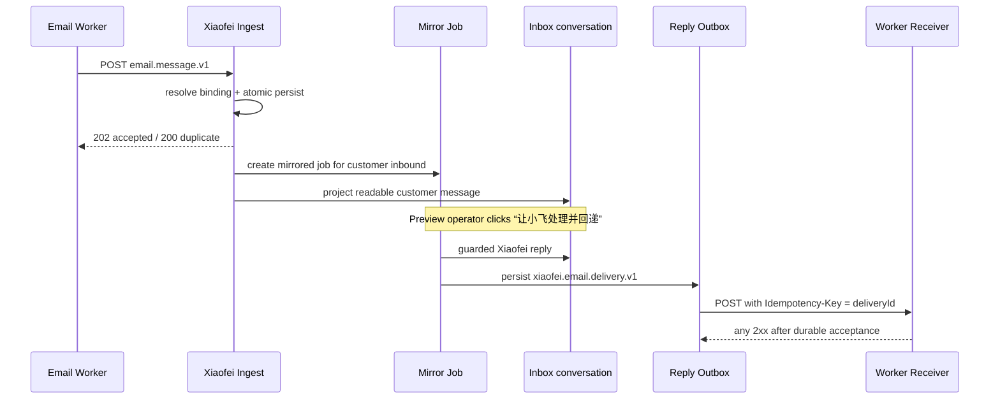

# Email Worker 双向联调指引

本文是 Worker/LoopDesk 同事与小飞联调 Email 的 P0 入口。页面版位于登录后的
`/integrations/email`，包含可复制参数、入站模拟、会话消费和回复回递入口。

## 一次完整联调



P0 仍然不在入站 HTTP 请求中等待模型。`202` 表示事件、消息、会话和 Mirror Job 已经可靠落库，
不表示小飞已经回复。Preview/UAT 由客服工作台显式执行待处理任务；正式后台消费者另行部署。

## 1. 准备邮箱绑定

Organization Owner/Admin 在 `/integrations/email-bindings` 维护三元组：

| 字段                     | 示例                         | 来源                   |
| ------------------------ | ---------------------------- | ---------------------- |
| `companyId`              | `fly103-preview-company`     | Worker 的外部商户 ID   |
| `channelAccount.id`      | `fly103-preview-mailbox-v2`  | 稳定邮箱账号/绑定 ID   |
| `channelAccount.address` | `support.fly103@example.com` | 规范化后的商户客服邮箱 |

三者必须同时匹配同一个启用绑定。Worker 不得发送 `workspaceId`；小飞只在服务端解析 Organization
Workspace。无绑定、禁用绑定或 ID/地址分裂都会在写入业务事实前拒绝。

## 2. Worker 投递 Email

```http
POST /api/xiaofei/integrations/v1/email/messages
Authorization: Bearer <environment-specific XIAOFEI_EMAIL_INGEST_API_KEY>
Idempotency-Key: <same value as eventId>
Content-Type: application/json
```

完整请求样例：[`acceptance/email-message.v1.example.json`](./acceptance/email-message.v1.example.json)。

| HTTP              | 含义                                             | Worker 动作                  |
| ----------------- | ------------------------------------------------ | ---------------------------- |
| `202`             | 新事件已提交数据库，符合条件的 Mirror Job 已创建 | 该 Company 目标成功          |
| `200`             | 相同 `eventId` 与业务 payload 的重投             | 成功，不创建第二条消息/任务  |
| `409`             | 相同 `eventId` 的业务 payload 已改变             | 隔离记录并告警，不改 ID 重试 |
| `400/413/415/422` | 永久请求错误                                     | DLQ/人工处理                 |
| `401`             | 环境服务密钥错误                                 | 停止目标并告警               |
| `5xx` / 超时      | 结果未知或暂时失败                               | 保留原 `eventId` 退避重试    |

Worker 只有在所有 Company 目标均收到 `200/202` 后才能提交对应 Kafka offset。

## 3. 确认小飞已经接收和消费

1. `/integrations/email-inbound` 可用可读表单生成与真实 Worker 相同的业务结构；
2. `/integrations/events` 查看入站 event、重复次数、规范化消息和 Mirror Job；列表默认不读取正文；
3. `/inbox` 查找 `email` 渠道会话。客户正文会显示为消息，状态依次为：
   `已接收，待小飞处理` → `小飞处理中` → `回复待回递` → `回复已回递`；
4. Preview/UAT 点击“让小飞处理并回递”。该动作复用当前 Organization 的知识、能力准入、
   LangGraph/Mastra 与 Guardrail，不把模型候选直接当作可发送回复。

Outbound `loopdesk`、`xiaofei` 或 `system` 邮件只补充会话上下文，不创建新 Mirror Job，避免发送回声
再次触发小飞。如果 Worker 能在邮件源回声中保留回递 payload 的 `message.sourceMessageId`，Inbox
投影会复用该 ID，不重复显示已在发送前保存的小飞回复；即使上游重新分配消息 ID，`senderType=xiaofei`
仍保证它不会创建第二个 AI 任务。

## 4. 配置回复 Receiver

`/integrations/email-delivery` 支持两种目标：

- **内置 Receiver Mock**：Preview/local 默认值，不访问外部网络；完整验证并记录同一份 payload；
- **真实 Receiver**：Organization Owner/Admin 填入公开 HTTPS URL。P0 拒绝 localhost、私网/保留地址、
  URL 账号密码、query 和 fragment；请求不跟随重定向，10 秒超时。

内置演示端点（仅 Vercel Preview 和本地开发启用）：

```http
POST /api/xiaofei/integrations/v1/email/delivery-mock
Content-Type: application/json
Idempotency-Key: <deliveryId>
```

真实 Receiver 收到同样的 `xiaofei.email.delivery.v1`。回复样例见
[`acceptance/xiaofei.email.delivery.v1.example.json`](./acceptance/xiaofei.email.delivery.v1.example.json)。
支持两种 event：

- `message.reply.requested`：Worker 应可靠保存，然后异步调用邮件源发送；
- `conversation.status.changed`：用于状态同步和联通测试，不应当作邮件正文发送。

Receiver 应按 `deliveryId` 幂等。小飞同时把它放在 `Idempotency-Key` 请求头中。Receiver 只需在可靠
保存后返回任意 `2xx`；推荐响应：

```json
{
	"status": "accepted",
	"deliveryId": "delivery:job:preview-001",
	"receivedAt": "2026-08-04T03:22:01.000Z"
}
```

非 `2xx`、超时或网络错误会把 Outbox 标为 `failed`，不删除 payload。修改 Receiver 设置后可在页面
用当前设置重试。已成功的回递不能从页面重复发送。

## P0 明确边界

- Receiver 尚未加入 Authorization/HMAC/mTLS。URL 内密钥被禁止；双方冻结鉴权方式后再扩展请求头，
  不改变业务 DTO；
- 自定义公网 URL 在发送前解析并拒绝私网/保留地址，但 DNS rebinding 的完全防护仍应由生产 egress
  proxy/网络策略补齐；
- 入站是 Mirror + 可观察持久任务，尚未部署常驻自动 Job Consumer；
- 附件只传受控引用和元数据，小飞不在入站事务或回复回递中下载附件；
- 页面、fixture 和文档只使用虚构参数，不包含服务密钥或真实客户数据。

## 最小验收清单

- [ ] 绑定 company/account/address；
- [ ] 客户入站返回 `202`，同一请求重投返回 `200`；
- [ ] `/inbox` 能看到同一个客户和消息正文；
- [ ] Mirror Job 只为 `inbound + customer` 创建；
- [ ] 内置 Mock 状态测试在 Outbox 显示 `delivered`；
- [ ] 小飞生成一条 Guardrail 后回复，Outbox payload 为 `message.reply.requested`；
- [ ] 错误 Receiver 显示 `failed`，更换地址后可重试；
- [ ] Worker 收到同一个 `deliveryId` 重投时不重复发邮件。
