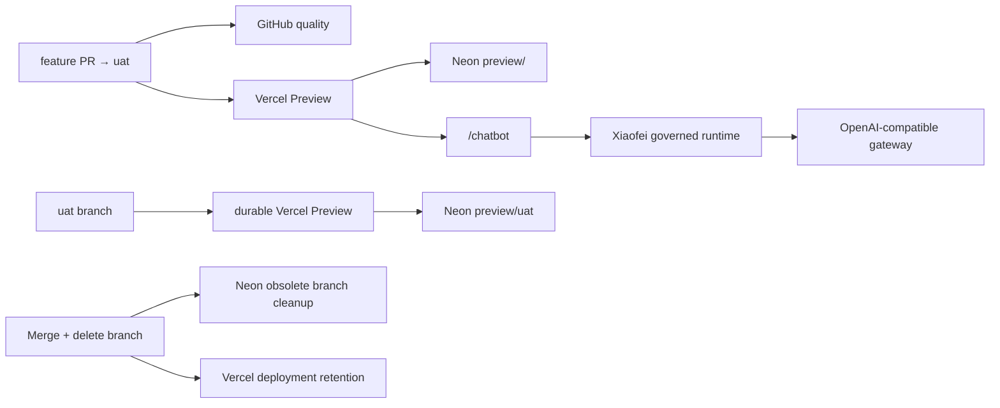

# GitHub → Vercel → Neon PR Preview CI/CD

This document describes the deployed delivery path for `pjxkqc/xiaofei`, the
required configuration, and the evidence expected before a pull request is
merged. Cloud credentials are never committed to the repository.

## Delivery flow

1. `main` is the only Production source: Vercel Production uses it with Neon
   `main`. `uat` is the durable UAT source: its Vercel branch Preview uses
   Neon `preview/uat`.
2. For normal delivery, create a short-lived feature branch from `uat` and open
   a pull request back into `uat`. Each feature PR retains its own Vercel
   Preview URL and Neon `preview/<feature-branch>` database branch.
3. GitHub Actions starts the `quality` workflow with a disposable PostgreSQL
   service. Vercel starts the Preview deployment independently.
4. GitHub runs lint, formatting, type checks, unit tests, production builds, and
   the SaaS and marketing Chromium suites.
5. The Vercel Git integration builds `apps/saas`. The Neon integration creates
   `preview/<git-branch>` from the Neon `main` branch and injects that branch's
   pooled and unpooled connection strings into the Preview build.
6. `scripts/vercel-build.mjs` applies the Prisma schema with the unpooled URL,
   restores the pooled runtime URL, and builds the application.
7. The Preview must pass the manual smoke checks below. A new push cancels stale
   GitHub work and replaces the branch alias with the latest deployment.
8. Reviewers pin UI feedback with Vercel Toolbar comments. Every unresolved
   comment keeps the `Vercel Preview Comments` check from passing.
9. Merge a feature only after GitHub quality, Vercel deployment, Preview
   comments, signup, database isolation, and the real streaming Chatbot have
   all passed.
10. GitHub deletes the merged short-lived feature branch. The
    `cleanup-preview-database` workflow immediately hard-deletes the matching
    disposable Neon database branch. Vercel retains immutable deployments
    according to project retention instead of deleting them synchronously.



GitHub and Vercel run in parallel. The CI database and the Vercel/Neon Preview
database are separate by design: CI is deterministic and disposable, while the
Preview database exists long enough for interactive product review.

## GitHub quality gate

`.github/workflows/validate-prs.yml` runs for pull requests into `main` or
`uat`, pushes to either branch, and manual dispatches. Its concurrency key is
the PR number or Git ref, with `cancel-in-progress: true`, so an older commit
cannot finish after and override the latest result.

The workflow:

- starts PostgreSQL 17 inside the GitHub-hosted runner;
- installs the locked pnpm and dependency versions;
- initializes a fresh schema;
- runs lint, formatting, type checks, unit tests, and all application builds;
- runs the SaaS and marketing browser suites in Chromium;
- uploads Playwright reports even when a test fails.

GitHub Actions receives placeholder application configuration only. It never
uses Vercel secrets, the Neon integration connection strings, or the real AI
gateway key.

Repository setting `delete_branch_on_merge` must remain enabled for disposable
feature and promotion branches. Never open `uat → main` directly: merging that
PR can delete the durable `uat` branch. For a production promotion, create a
temporary `promote/uat-YYYYMMDD-*` branch from `uat`, open that branch's PR to
`main`, and merge only after its gates pass. Then fast-forward `uat` to the
latest `main`. This keeps the long-lived UAT deployment and data branch intact
while returning it to the released baseline.

## Preview UI feedback

Vercel Toolbar is the visual review surface; GitHub remains the delivery and
automation surface. The shortest feedback loop is:

1. Open the current PR Preview and use the Toolbar to pin a comment to the exact
   button or element. Include the expected appearance or behavior.
2. Leave the comment unresolved. Vercel updates the PR's
   `Vercel Preview Comments` check, so the open feedback is visible to the merge
   gate. A comment does not edit code or start GitHub Actions by itself.
3. If the feedback needs issue tracking, convert the comment to a GitHub issue
   through the Vercel Comments GitHub integration. The issue preserves the
   deployment and visual context and can then be assigned to an implementation
   agent.
4. The implementer pushes a fix to the same PR. GitHub quality and Vercel deploy
   the new commit normally.
5. Reopen the newest Preview, verify the pinned location, and resolve the
   comment. Only then should the Preview Comments check pass.

CI validates committed code; it does not autonomously interpret or repair a
Toolbar comment. Automated repair would require a separate GitHub
issue-to-agent bridge. Do not add that bridge until the manual
comment-to-issue flow is stable and its permissions are intentionally scoped.

`.github/workflows/cleanup-preview-database.yml` runs only for a same-repository
PR `closed` event. It looks up the exact `preview/<head-ref>` branch and calls
the Neon delete API. It never searches by a partial branch name and cannot
select `main`. `uat` returns `preserved` before any Neon request, so its durable
`preview/uat` branch cannot be deleted by this workflow. Missing or
already-deleted disposable branches are successful no-ops, so a rerun is safe.
GitHub stores the project-scoped `NEON_API_KEY` as an Actions secret and the
non-secret `NEON_PROJECT_ID` as an Actions variable.

## Vercel configuration

- Project: `flyranking16/xiaofei-preview`
- Production URL: `https://xiaofei-preview.vercel.app`
- Git repository: private `pjxkqc/xiaofei`
- Root Directory: `apps/saas`
- Vercel build runtime: Node.js 24.x
- GitHub quality runtime: Node.js 22; repository minimum: Node.js 22
- System environment variables: enabled

Do not set a fixed `NEXT_PUBLIC_SAAS_URL` for Preview. Better Auth builds an
exact trusted-host list from Vercel's production, branch, and deployment system
variables, so every PR URL works without trusting the global
`https://*.vercel.app` namespace.

The following server-only variables are set for **Production and Preview**:

| Variable                | Purpose                                           |
| ----------------------- | ------------------------------------------------- |
| `BETTER_AUTH_SECRET`    | Signs authentication data                         |
| `MAIL_PROVIDER=console` | Avoids external email delivery in this test setup |
| `OPENAI_API_KEY`        | Authenticates the AI gateway; sensitive           |
| `OPENAI_BASE_URL`       | OpenAI-compatible `/v1` endpoint                  |
| `OPENAI_MODEL`          | Exact model ID returned by the gateway            |

None of these variables may use a `NEXT_PUBLIC_` prefix. Changing a Vercel
variable affects new deployments only; redeploy the relevant commit or push a
new commit after a rotation.

`uat` reuses the existing Vercel Preview variables; no additional current secret
is required. Better Auth and Preview one-click login use the same Preview
behavior as feature branches. Vercel Custom Environments are not required for
this design.

## Neon isolation and schema initialization

- Project: `neon-bronze-paddle`
- Region: AWS Singapore
- Plan: Free
- Integration environments: Production and Preview
- Obsolete branch cleanup: enabled

The integration injects `DATABASE_URL` for pooled application traffic and
`DATABASE_URL_UNPOOLED` for schema work. `scripts/vercel-build.mjs` also accepts
`DIRECT_URL` as an unpooled fallback. The build fails by variable name when
either connection class is missing; it never prints a connection string.

Every feature Preview must show a distinct `preview/<git-branch>` branch in
Neon. The durable `uat` branch maps to `preview/uat`; Production uses Neon
`main`. A Preview must never silently fall back to the production database.
Neon branches are copy-on-write: they begin with a copy of their parent data and
subsequent writes are isolated. UAT must not contain real sensitive customer
data.

## Durable UAT operating procedure

After this change is merged, a controller performs these manual steps (this PR
does not create `uat`, change cloud configuration, or alter production):

1. Create `uat` from the latest `main`, then push it. Confirm the GitHub
   `quality` workflow runs for the push.
2. Confirm the stable Vercel `uat` branch alias is Ready and Neon has
   `preview/uat`.
3. Use Preview one-click login for a minimal smoke test. Trigger one `uat`
   redeployment and confirm its UAT data remains present.
4. Confirm Vercel Production remains on `main` and Neon `main` is unchanged.

For day-to-day work, target feature PRs to `uat`; their branch Preview URLs and
`preview/<feature-branch>` databases remain disposable and are cleaned after
close. To release, follow the temporary `promote/uat-YYYYMMDD-* → main` flow
above, then fast-forward `uat` to `main`.

Current platform limits require manual protection: GitHub Free private
repositories cannot enforce branch protection, Neon Free has no protected
branch, and named Vercel Custom Environments require a paid plan. Treat `main`
and `uat` as controller-managed branches; do not delete, force-push, or directly
merge `uat → main`.

## Chatbot request path

The browser calls the same-origin `/api/rpc` endpoint. The authenticated
`ai.stream` procedure loads the tenant workspace and conversation, runs the
LangGraph state machine through the vendor-neutral Xiaofei kernel, invokes
Mastra Agent generation only on the permitted reply path, persists state and
traces, and returns text only after final Guardrail authorization. Model calls
use `@ai-sdk/openai` in explicit Chat Completions mode:

```text
Browser /chatbot
  → same-origin /api/rpc
  → protected server procedure
  → tenant workspace + conversation state
  → LangGraph StateGraph
  → Mastra Agent when candidate generation is permitted
  → OPENAI_BASE_URL/chat/completions when generation is permitted
  → Xiaofei Guardrail + owner lease check
  → persisted state + business traces
  → streamed UI message
```

`OPENAI_API_KEY`, `OPENAI_BASE_URL`, and `OPENAI_MODEL` are read only on the
server. The client bundle and browser network requests never receive the
gateway key. Omitting the key fails with `OPENAI_API_KEY is required.` without
including any secret value.

## Required PR verification

For every infrastructure-affecting PR:

1. Confirm GitHub `lint-type-test-build` succeeds for the latest commit.
2. Confirm Vercel reports the latest Preview deployment as Ready.
3. Confirm Neon shows one branch named for the PR's Git branch.
4. Create a disposable user on the Preview; registration must return success
   and continue to `/onboarding` without email verification.
5. Finish onboarding, open `/agent-settings`, save the default configuration,
   and confirm the Mastra governance Workflow completes.
6. Run P0 Eval and confirm all deterministic assertions pass.
7. Open `/chatbot` and verify LangGraph multi-turn collection plus the
   Mastra-generated service-scope reply. Confirm framework, KU, owner, action,
   and trace evidence appears and a high-risk request transfers to a human.
8. Confirm Vercel runtime logs show successful auth and AI requests with no
   `Invalid origin`, database, or provider errors.
9. Merge the PR, confirm GitHub deletes the source branch, and confirm
   `delete-neon-preview-branch` removes the corresponding Neon Preview branch.
10. Confirm the production deployment becomes Ready and the `main` quality
    workflow succeeds.

Never put test passwords, API keys, database URLs, or response headers into a
PR description, Actions artifact, screenshot, or application log.

## Observed cleanup behavior

The first merged Preview PR demonstrated an important lifecycle detail:

- merging PR #1 did not remove its remote source branch because automatic
  branch deletion was not yet enabled;
- while that Git branch existed, Neon kept
  `preview/chore/verify-pr-preview` active and Vercel kept the associated
  Preview deployment;
- the remote branch was then deleted explicitly to trigger and observe cleanup.

Deleting the Git branch made the Neon compute idle but did not immediately
delete the database branch. The explicit PR-close cleanup workflow was added as
a result. Neon branch deletion is asynchronous and should be verified in the
Neon Branches page. Vercel deployment cleanup is different: immutable Preview
deployments can remain visible and reachable until Vercel's deployment
retention policy removes them. Database cleanup, not immediate deletion of the
immutable Vercel deployment record, is the required resource-isolation signal.

## Troubleshooting

- `403 Invalid origin`: confirm Vercel system variables are enabled and Better
  Auth receives the current deployment host.
- Prisma schema failure: confirm both pooled and unpooled Neon variables exist
  for the same Preview environment.
- Chat provider error: validate `/models`, the configured model ID, and
  streaming `/chat/completions` compatibility from a trusted machine.
- Preview points at stale code: inspect the deployment commit and branch alias,
  then push a new commit or redeploy after environment-variable changes.
- Neon branch remains after merge: confirm the Git source branch was deleted,
  obsolete branch cleanup is enabled, and no active Vercel deployment still
  references it.
