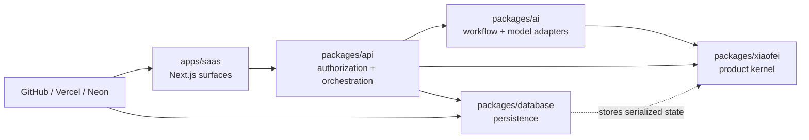

# Repository structure and ownership

This document is the routing map for code changes. It explains where a change
belongs, which dependencies are allowed, and which checks provide useful
evidence. It does not replace the README beside each implementation boundary.

## Dependency direction



Dependencies point toward stable contracts. The product kernel returns
decisions and evidence; it never knows which page, framework, database, model
provider, or customer channel invoked it.

## Ownership map

| Boundary                    | Primary paths                                                                   | Owns                                                                                           | Must not own                                                                  |
| --------------------------- | ------------------------------------------------------------------------------- | ---------------------------------------------------------------------------------------------- | ----------------------------------------------------------------------------- |
| Product kernel              | `packages/xiaofei/**`                                                           | Agent, KU, policy, ownership, handoff, trace, Eval, and deterministic runtime decisions        | Next.js, oRPC, Prisma, Mastra, LangGraph, model or channel SDKs               |
| AI adapters                 | `packages/ai/**`                                                                | LangGraph orchestration, Mastra governance and generation, provider adapters                   | Tenant authorization, customer-visible send authorization, persistence schema |
| Application                 | `apps/saas/**`                                                                  | Public support UI, support inbox, Chatbot validation, settings, browser state                  | Secrets, direct Prisma/model calls, business invariants                       |
| API                         | `packages/api/**`                                                               | oRPC contracts, tenant/support authorization, use-case orchestration, persistence transactions | UI state, provider-specific model types                                       |
| Persistence                 | `packages/database/**`                                                          | Prisma schema/client, migrations or schema sync, durable snapshots and messages                | Product policy or workflow routing                                            |
| Platform                    | `.github/workflows/**`, `scripts/**`, `vercel.json`                             | CI quality gates, PR Preview database lifecycle, build/deploy wiring                           | Product behavior                                                              |
| Cross-cutting foundation    | `packages/auth/**`, `packages/i18n/**`, `packages/ui/**`, other shared packages | Supastarter framework capabilities                                                             | Xiaofei-specific policy unless exposed through an explicit boundary           |
| Architecture and operations | `README.md`, `AGENTS.md`, `docs/**`, boundary READMEs                           | Stable decisions, contributor guidance, validation and operations                              | Secrets or transient deployment values                                        |

When a feature crosses rows, split it into child issues with one owner per row.
Define or change the stable contract first, then let outer layers consume it.

## Product data path

```text
customer or support UI
  → same-origin oRPC
  → authenticated/public procedure and tenant boundary
  → persisted workspace + conversation state
  → LangGraph orchestration
  → domain admission and ownership decision
  → Mastra candidate generation only when admitted
  → final domain Guardrail and lease check
  → persisted result and customer-visible channel response
```

Two rules protect this path:

1. a model candidate is not an authorized customer reply;
2. a conversation owner transition invalidates replies captured under an older
   `ownerEpoch`.

Read [`xiaofei-foundation.md`](./xiaofei-foundation.md) before changing either
rule.

## Change routing and validation

| Change type                         | Start in                       | Minimum focused evidence                                                                     |
| ----------------------------------- | ------------------------------ | -------------------------------------------------------------------------------------------- |
| Domain contract or invariant        | `packages/xiaofei`             | `pnpm --filter @repo/xiaofei test` and `type-check`                                          |
| LangGraph, Mastra, or model adapter | `packages/ai`                  | `pnpm --filter @repo/ai test` and `type-check`                                               |
| Xiaofei procedure or authorization  | `packages/api/modules/xiaofei` | `pnpm --filter @repo/api test` and `type-check`                                              |
| SaaS page or interaction            | `apps/saas`                    | `pnpm --filter saas test` and `type-check`; add targeted E2E evidence when behavior changes  |
| Prisma model or persistence         | `packages/database/prisma`     | generate the client, run the owning package checks, and prove migration/schema compatibility |
| CI/CD or Preview lifecycle          | `.github/workflows`, `scripts` | script tests plus a real PR lifecycle when cloud behavior changes                            |
| Documentation only                  | owning README or `docs`        | `pnpm format:check` and link/path review                                                     |

Before merge, the repository quality workflow remains the authority for the
complete `lint`, formatting, type-check, test, and build matrix.

## Documentation hierarchy

Use one canonical source for each kind of information:

1. `README.md` — product entry point and local setup;
2. `AGENTS.md` — repository-wide coding and safety rules;
3. `docs/xiaofei-*.md` — cross-boundary product architecture and invariants;
4. `docs/pr-preview-setup.md` — delivery and Preview operations;
5. `docs/multica/**` — Agent creation, ownership, routing, and handoff;
6. a boundary README — implementation-specific extension points and tests.

Update the owning document in the same PR when behavior, boundaries, or
operating steps change. Link to it elsewhere instead of copying it.
