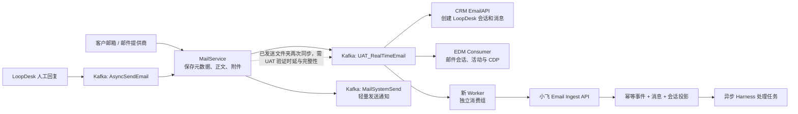
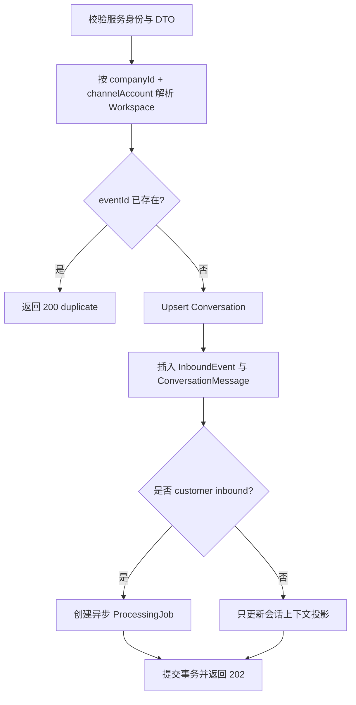

# 小飞 × Email Kafka Worker 消息接入交接文档

> 状态：实施交接稿，3 个事项待双方冻结<br>
> 调研日期：2026-08-03<br>
> 代码基线：`CcituService.Mail/UAT`、`CcituEDM/UAT`、`ccitucrm/UAT`、`xiaofei-main/uat`<br>
> 读者：小飞主工作会话、Email Worker/LoopDesk 开发同事、UAT 测试同事

本文将《客服消息链路》的调研结论落实到当前 Email Kafka 源码，目标是让：

1. 小飞主工作会话先实现一个稳定、可幂等的 Email 消息接收接口；
2. Worker 同事消费现有 Email Kafka，将原始消息归一化后投递给小飞；
3. 双方在联调前冻结租户、会话、方向和人工回复的口径；
4. 消息重复、失败重试、乱序和敏感数据处理在第一版就有明确边界。

本文只定义消息“进入小飞”的桥接。小飞回复、请求处理、请求接管如何写回统一消息源，后续按双方
另行冻结的消息源与托管状态契约实施。

---

## 1. 可直接交给小飞主工作会话的任务摘要

请基于本文实现 P0 Email 消息接入，核心范围如下：

1. 新增服务间接口：`POST /api/xiaofei/integrations/v1/email/messages`；
2. 新增独立的服务身份认证，不复用浏览器 Session、公开客服接口或 `supportProcedure`；
3. 按 `eventId` 幂等落库，成功持久化后才返回 `2xx`；
4. 由 `companyId + channelAccount` 在服务端解析 Xiaofei Workspace，调用方不能指定 `workspaceId`；
5. 将原始事件、规范化消息、会话投影、处理任务分层存储，不再只追加到
   `XiaofeiConversation.messages` JSON；
6. 只有 `direction=inbound` 且 `senderType=customer` 的新消息创建 AI 处理任务；
7. LoopDesk 人工发信和小飞自身发信只补充上下文，不能再次触发 AI；
8. HTTP 请求只完成认证、校验、落库和入队，不在请求内等待模型处理；
9. 覆盖重复投递、跨租户、乱序、人工消息不触发 AI、失败重试等测试。

第一阶段可先完成 **Mirror 模式**：接收、落库、对账，不自动回复。这样可以先与 Worker 联调，
再逐步开放 Harness 处理和真实渠道发送。

---

## 2. 已确认结论

### 2.1 接入边界

- Email Kafka 长连接由常驻 Worker 维护，Worker 建议以 Docker/容器部署；Vercel 请求处理器只提供
  HTTPS 接口，不直接维护 Kafka Consumer。
- Worker 是 Email 消息源的基础设施适配器，不承载 LoopDesk 页面业务，也不调用小飞内部模型接口。
- 原始 Kafka DTO 不是小飞的长期领域契约。Worker 必须先完成字段归一、租户展开、方向判断和稳定
  ID 生成，再调用小飞接口。
- 消息采用“至少一次投递 + 接收端幂等”。不能依赖 Kafka、网络或 HTTP 恰好只执行一次。

### 2.2 第一阶段数据源

第一阶段以 `RealTimeEmail` 为完整邮件数据源：

| 环境               | Topic                                            | 说明                                  |
| ------------------ | ------------------------------------------------ | ------------------------------------- |
| UAT                | `UAT_RealTimeEmail`                              | Prefix `UAT_` + Topic `RealTimeEmail` |
| 现有 CRM 消费组    | `GroupLoop_2026UAT-RealTimeEmail`                | 仅作现状参考，Worker 不得复用         |
| 小飞 Worker 消费组 | 待冻结，例如 `GroupXiaofei_UAT-RealTimeEmail-v1` | 必须使用新的独立消费组                |

独立消费组保证 CRM、EDM 和小飞 Worker 各自获得完整副本，不发生竞争消费。

### 2.3 当前实际链路



`RealTimeEmail` 已确认同时被 CRM 与 EDM 的不同消费组使用；EDM 的该消费者不会再把同一事件经
`CRMReceiveMail` 转发给 CRM。`CRMReceiveMail` 是另一条仍存在的 RabbitMQ 输入支路，不是本次
Worker 的主数据源。

---

## 3. `RealTimeEmail` 实际 Kafka 结构

### 3.1 线格式

- 生产 DTO：`ABP.MailService.Mail.Dto.RealTimeEmailMessage`；
- 默认使用 Newtonsoft.Json 序列化为 UTF-8 JSON；
- 当前字段名按 .NET 属性名输出，为 PascalCase；
- 当前没有 Schema Registry，也没有消息内 `schemaVersion`；
- Worker 读取时可大小写不敏感，但必须显式映射，不应直接透传动态 JSON。

### 3.2 字段表

| Kafka 字段                  | 类型           | 源码语义                                                                              | Worker 使用方式                                  |
| --------------------------- | -------------- | ------------------------------------------------------------------------------------- | ------------------------------------------------ |
| `MessageId`                 | `long`         | MailService 的 `MessageBusId`，当前 CRM 将其作为 `ExternalMessageID`                  | 主要业务消息 ID；不要用 Kafka offset 代替        |
| `FromAddress`               | `string`       | 实际发件地址                                                                          | 配合卖家邮箱集合判断方向                         |
| `ReceiveAddress`            | `string`       | 当前通知对应的收件地址                                                                | 一封多收件人邮件可能产生多条通知                 |
| `FansName`                  | `string`       | 粉丝/对端显示名，含方向相关处理                                                       | 仅作显示信息，不能作为客户 ID                    |
| `Subject`                   | `string`       | 邮件主题                                                                              | 原样保存，模型输入前再规范化                     |
| `Content`                   | `string`       | 邮件正文                                                                              | 结合 `ContentType` 解释，禁止写入普通日志        |
| `ContentType`               | `string`       | 如 `text/html`、`text/plain`                                                          | 小飞侧负责安全净化、提取可读文本                 |
| `SendTime`                  | `DateTime`     | 邮件发生时间                                                                          | Worker 统一转为 ISO 8601 UTC；保留原始值用于追踪 |
| `Attachments`               | `Attachment[]` | 已保存的附件引用                                                                      | 只传引用和元数据，不传附件字节                   |
| `Attachments[].Url`         | `string`       | OSS 或受控文件地址                                                                    | 不在日志中输出完整签名 URL                       |
| `Attachments[].ContentType` | `string`       | 附件 MIME                                                                             | 作为展示和安全扫描提示，不完全信任               |
| `Attachments[].Name`        | `string`       | 附件名                                                                                | 需要长度限制和字符清理                           |
| `Attachments[].Size`        | `long`         | 附件大小                                                                              | 用于策略判断，不由 Worker 下载附件               |
| `Labels`                    | `string[]`     | 邮件标签                                                                              | 作为可选元数据保存                               |
| `SubscribeEmail`            | `string`       | MailService 正在订阅/操作的邮箱                                                       | 解析邮箱绑定、公司和别名集合的入口               |
| `MailReferences`            | `string[]`     | RFC References 列表                                                                   | 用于邮件线程关联和追踪                           |
| `Flag`                      | `string`       | 业务自定义标记                                                                        | 原样作为可选元数据，不把其内部格式固化到小飞领域 |
| `MailMessageId`             | `string`       | 原始 RFC/Graph Message-ID                                                             | 提供者消息 ID；引用、排障和补充去重使用          |
| `ReferenceId`               | `long`         | 被引用邮件的 MailService `MessageBusId`                                               | 映射为 `replyToSourceMessageId`                  |
| `SendType`                  | `int`          | 当前代码注释为 `1=系统发送、0=外部、10=其他`，不同拉取/发送路径使用并不等同于客服方向 | **不得单独用于判断 customer/loopdesk**           |

Kafka 原始示意：

```json
{
	"MessageId": 987654321,
	"FromAddress": "customer@example.com",
	"ReceiveAddress": "support@example.com",
	"FansName": "Customer",
	"Subject": "Where is my order?",
	"Content": "<p>...</p>",
	"ContentType": "text/html",
	"SendTime": "2026-08-03T03:20:00Z",
	"Attachments": [
		{
			"Url": "https://controlled-object-reference/...",
			"ContentType": "image/png",
			"Name": "photo.png",
			"Size": 12345
		}
	],
	"Labels": [],
	"SubscribeEmail": "support@example.com",
	"MailReferences": ["<previous@example.com>"],
	"Flag": "",
	"MailMessageId": "<current@example.com>",
	"ReferenceId": 987654000,
	"SendType": 10
}
```

示例地址和 ID 均为虚构值。

### 3.3 CRM DTO 不是完整源结构

当前 CRM 的 `RealTimeEmailDto` 比 MailService 原始 DTO 少两个重要信息：

- 没有 `MailMessageId`；
- CRM 的附件 DTO 没有 `ContentType`。

所以 Worker 的原始反序列化模型应以 MailService 的 `RealTimeEmailMessage` 为准，不能复制 CRM 的
`RealTimeEmailDto` 后认为字段已经完整。

---

## 4. 方向、租户与会话如何确定

### 4.1 不使用 `SendType` 判断方向

Worker 必须先根据 `SubscribeEmail` 取得有效邮箱绑定，并展开该公司下的主邮箱、父子邮箱和别名集合
`sellerEmailSet`，再判断：

```text
FromAddress ∈ sellerEmailSet
  → direction = outbound
  → senderType = loopdesk（或后续由来源细分为 xiaofei/system）
  → sellerEmail = FromAddress
  → customerEmail = ReceiveAddress

否则
  → direction = inbound
  → senderType = customer
  → sellerEmail = ReceiveAddress
  → customerEmail = FromAddress
```

该规则与当前 CRM `RealTimeEmailConsumerService` 的主要方向判断保持一致。所有邮箱比较应先去空格并
转小写，避免大小写导致方向反转。

### 4.2 一个原始事件可能展开为多个租户事件

`SubscribeEmail` 可能关联多个 Company。当前 CRM 会按查询到的 Company 逐个处理。Worker 也应：

1. 通过邮箱绑定服务/仓储查出所有有效 Company；
2. 对每个 Company 使用其自己的 `sellerEmailSet` 判断方向；
3. 每个 Company 生成一个独立的规范化事件；
4. 只有全部目标事件已被小飞接受，才确认当前 Kafka 消息；生产化后也可使用 Worker Outbox 解耦。

不能只取第一家公司，也不能让小飞依据调用方传入的 `workspaceId` 直接落库。

### 4.3 稳定 ID 规则

第一阶段建议冻结以下规则：

| ID                        | 建议规则                                                   | 说明                                       |
| ------------------------- | ---------------------------------------------------------- | ------------------------------------------ |
| `eventId`                 | `email:realtime:{companyId}:{MessageId}:{addressPairHash}` | API 幂等键；公司展开后仍唯一               |
| `sourceMessageId`         | `email:{MessageId}`                                        | MailService 业务消息 ID                    |
| `providerMessageId`       | `MailMessageId`                                            | 原始 RFC/Graph Message-ID，可为空          |
| `replyToSourceMessageId`  | `email:{ReferenceId}`                                      | `ReferenceId > 0` 时生成                   |
| `channelAccountId`        | Worker/LoopDesk 的稳定邮箱绑定 ID                          | 优先使用邮箱实体 ID，不以显示名代替        |
| `conversation.externalId` | `email:{companyId}:{addressPairHash}`                      | 同公司、卖家邮箱、客户邮箱组成的稳定会话键 |

`addressPairHash` 建议由规范化后的 `sellerEmail + "|" + customerEmail` 生成 SHA-256 并使用短前缀或
完整十六进制值。这样会话 ID 不直接暴露邮箱，同时不依赖 CRM 会话是否已经完成落库。

如 LoopDesk 已能稳定提供一个跨重试不变的 `sourceConversationId`，双方也可直接冻结该 ID；但在联调
开始后不能再从“地址对 ID”无迁移地切换为 CRM `SessionId`。`loopdeskSessionId` 可作为可选关联字段，
不应成为接收 Email 的前置条件。

### 4.4 小飞 Workspace 解析

小飞服务端维护 Channel Binding：

```text
companyId + channel=email + channelAccountId/address
  → XiaofeiWorkspace
```

Worker 只提交外部公司与渠道账号身份；API 在服务端解析 Workspace。绑定不存在、被禁用或出现多个
冲突结果时，接口必须拒绝并返回可排查错误，不能落入默认 Workspace。

---

## 5. 小飞接收接口契约

### 5.1 Endpoint 与认证

建议新增 OpenAPI 路由：

```http
POST /api/xiaofei/integrations/v1/email/messages
Authorization: Bearer <environment-specific-service-token>
Idempotency-Key: <same-as-eventId>
Content-Type: application/json
```

P0 可先使用按环境隔离、可轮换的 Bearer Service Token；服务身份必须独立于浏览器登录 Token。实现时
新增 `serviceProcedure` 或同等中间件，并限制到指定集成身份。后续若网络边界要求更高，可在不改变
业务 DTO 的前提下升级为 HMAC 或 mTLS。

不要在源码、文档、日志或错误响应中记录 Token、Kafka 凭据和完整认证头。

### 5.2 请求体 `email.message.v1`

```json
{
	"schemaVersion": "email.message.v1",
	"eventId": "email:realtime:42:987654321:1d56...",
	"occurredAt": "2026-08-03T03:20:00.000Z",
	"tenant": {
		"companyId": "42"
	},
	"channel": "email",
	"channelAccount": {
		"id": "mailbox_123",
		"address": "support@example.com"
	},
	"conversation": {
		"externalId": "email:42:1d56...",
		"loopdeskSessionId": null
	},
	"message": {
		"sourceMessageId": "email:987654321",
		"providerMessageId": "<current@example.com>",
		"replyToSourceMessageId": "email:987654000",
		"direction": "inbound",
		"senderType": "customer",
		"from": {
			"address": "customer@example.com",
			"name": "Customer"
		},
		"to": [
			{
				"address": "support@example.com",
				"name": null
			}
		],
		"subject": "Where is my order?",
		"content": {
			"type": "text/html",
			"value": "<p>...</p>"
		},
		"attachments": [
			{
				"url": "https://controlled-object-reference/...",
				"contentType": "image/png",
				"name": "photo.png",
				"size": 12345
			}
		],
		"sentAt": "2026-08-03T03:20:00.000Z",
		"labels": [],
		"sourceSendType": 10
	},
	"source": {
		"system": "mail-service",
		"topic": "UAT_RealTimeEmail",
		"partition": 0,
		"offset": 123456,
		"workerVersion": "git-sha-or-image-tag"
	}
}
```

契约约束：

- `eventId`、`companyId`、`conversation.externalId`、`sourceMessageId`、方向、发/收件地址和时间必填；
- `providerMessageId`、`replyToSourceMessageId`、名称、附件、标签和 `loopdeskSessionId` 可空；
- `source.topic/partition/offset` 只用于追踪，不参与业务幂等；
- 不允许 Worker 传 `workspaceId`、`ownerEpoch`、`hostingVersion` 或“是否触发 AI”等内部决策字段；
- `content.value` 不允许静默截断。超出双方冻结的请求上限时进入 DLQ，或改用受控正文引用；
- 附件只传受控引用与元数据，小飞接口不在接收事务内下载附件；
- 小飞需保留原始 HTML 作为受限数据，并另行生成经过净化的可读文本供模型使用。

### 5.3 返回语义

| HTTP      | 业务语义                                     | Worker 行为                            |
| --------- | -------------------------------------------- | -------------------------------------- |
| `202`     | 新事件已在小飞数据库持久化并成功创建后续任务 | 视为成功                               |
| `200`     | `eventId` 已处理，返回相同业务定位           | 视为成功，不重复创建任务               |
| `400/422` | 结构或业务字段永久无效                       | 不无限重试；进入 DLQ 并告警            |
| `401/403` | 服务身份、权限或密钥错误                     | 停止该目标投递并告警，禁止降级匿名调用 |
| `429`     | 小飞限流                                     | 按 `Retry-After` 或退避重试            |
| `5xx`     | 小飞暂时不可用或事务失败                     | 保留原 `eventId` 重试                  |

成功示例：

```json
{
	"status": "accepted",
	"eventId": "email:realtime:42:987654321:1d56...",
	"conversationId": "internal-conversation-id",
	"externalConversationId": "email:42:1d56...",
	"messageId": "internal-message-id"
}
```

重复示例中的 `status` 为 `duplicate`，其余定位信息保持一致。`202` 必须表示“已经可靠落库”，不能只
表示 HTTP 进程把内存任务启动了。

---

## 6. 小飞侧建议存储结构

当前 `XiaofeiConversation` 使用 `messages Json` 与 `traceEvents Json`，适合现有演示，但不适合作为外部
消息的幂等账本。建议补充以下持久化边界：

| 表/模型                          | 关键字段                                                                                                     | 作用                                      |
| -------------------------------- | ------------------------------------------------------------------------------------------------------------ | ----------------------------------------- |
| `XiaofeiChannelBinding`          | `workspaceId`、`companyId`、`channel`、`channelAccountId`、`address`、`status`                               | 外部租户与渠道账号到 Workspace 的安全映射 |
| `XiaofeiInboundEvent`            | `workspaceId`、`eventId`、source topic/partition/offset、`payloadHash`、`occurredAt`、`ingestedAt`、`status` | 原始接入账本、幂等、审计与重放            |
| `XiaofeiConversationMessage`     | `conversationId`、`eventId`、`sourceMessageId`、方向、发送人、正文、附件、`occurredAt`                       | 可查询、可分页的规范化消息事实            |
| `XiaofeiProcessingJob` 或 Outbox | `eventId`、`conversationId`、状态、尝试次数、`ownerEpoch`、下次执行时间                                      | 将 HTTP 接收与 Harness/模型处理解耦       |
| `XiaofeiConversation`            | 现有 `externalId`、聚合状态和必要投影                                                                        | 保存当前会话状态，不承担全量事件账本      |

建议唯一约束：

```text
XiaofeiChannelBinding: unique(companyId, channel, channelAccountId)
XiaofeiInboundEvent:   unique(workspaceId, eventId)
ConversationMessage:  unique(workspaceId, eventId)
XiaofeiConversation:  unique(workspaceId, externalId)  # 已存在
```

接收事务顺序：



只有数据库事务提交后才能返回成功。AI 任务从持久化消息恢复上下文；Broker 重放或 API 重试不能产生
第二条消息、第二次模型调用或第二封回复。

---

## 7. Worker 开发要求

### 7.1 处理流程

```text
消费 UAT_RealTimeEmail
  → 反序列化 MailService RealTimeEmailMessage
  → 基于 SubscribeEmail 解析邮箱绑定与全部 Company
  → 按 Company 的 sellerEmailSet 计算方向与地址对
  → 每个 Company 生成一个 email.message.v1
  → POST 小飞 Ingest API
  → 所有目标均收到 200/202 后才提交 Kafka offset
```

### 7.2 必须实现

- 使用新的、按环境隔离的 Consumer Group；
- 使用 MailService 原始 DTO，而不是字段不完整的 CRM DTO；
- 对邮箱地址做统一规范化，按公司展开并计算方向；
- 固定 `eventId` 算法，重试和人工重放保持同一 ID；
- 超时、`429` 和 `5xx` 指数退避重试，并加入随机抖动；
- 永久失败进入 DLQ，支持保留原 `eventId` 的人工重放；
- 只有小飞返回 `200/202` 后才视为该公司目标成功；
- 一条 Kafka 消息展开为多个公司时，必须记录每个投递目标的结果；
- 暴露健康检查、消费延迟、成功、重复、重试、无绑定、无效 DTO 和 DLQ 指标；
- 日志只记录 `eventId`、`MessageId`、Company、Topic/Partition/Offset、耗时和错误分类；
- 不记录正文、完整附件 URL、认证头、Kafka 凭据；邮箱应脱敏或哈希。

### 7.3 禁止复制现有 CRM 的提前提交方式

当前 CRM 的一段旧消费实现会先 `Task.Run` 启动业务任务，再提交 Kafka offset，业务任务失败时可能已经
失去原 offset。新 Worker **不得复制这一实现**。

P0 最小实现可以等所有小飞 HTTP 目标成功后再提交 offset。生产化时若不希望小飞短时故障阻塞 Kafka
分区，应增加 Worker 本地 Outbox：先在一个事务中保存 Kafka 事件及全部投递目标，再提交 offset，随后
由 Dispatcher 独立重试 HTTPS 投递。

### 7.4 顺序

当前 MailService Kafka Producer 没有按 `conversationId` 设置稳定消息 Key，不能假设同一会话天然有序。
Worker 与小飞至少一侧必须按 `conversation.externalId` 串行化处理；同时保存 `occurredAt` 和
`ingestedAt`，允许迟到消息补入历史。

第一阶段若 Worker 单并发消费，也不能把“UAT 当前线程数为 1”当作永久顺序保证。

---

## 8. LoopDesk 人工回复：已知事实、风险与推荐做法

### 8.1 已确认的三个事件

| 事件             | 时点                                       | 是否有完整正文 | 是否已确认发送成功                       | 是否有 Company/CRM Session |
| ---------------- | ------------------------------------------ | -------------- | ---------------------------------------- | -------------------------- |
| `AsyncSendEmail` | CRM 已保存发送中消息，准备调用 MailService | 有             | 否，发生在实际发送前                     | 有                         |
| `MailSystemSend` | MailService 发送流程后发出轻量通知         | **无**         | DTO 没有成功/失败字段，不能仅凭它判断    | 无                         |
| `RealTimeEmail`  | 邮件被 MailService 拉取/保存并发布实时邮件 | 有             | 对收件主链路明确；已发送文件夹同步需验证 | 无                         |

`MailSystemSend` 的实际字段只有：`MessageId`、From/Receive、Send/Receive Name、`SendTime`、
`Source`、`SubscribeEmail`、`SendType`、Cc、Bcc。它没有 Subject、Content、ContentType、附件、
`MailMessageId` 和发送结果。因此不能把它直接当成小飞所需的完整人工回复消息。

`AsyncSendEmail` 虽有 CRM Session、Company 和正文，但它是“发送命令”，不是“已成功发送的消息事实”。
若小飞把它直接加入上下文，发送失败时还需要额外状态回滚。

### 8.2 第一阶段推荐

先只消费 `RealTimeEmail`，并在 UAT 完成一次人工回复闭环验证：

1. 从 LoopDesk 对一个测试会话发送 Email；
2. 记录 CRM `SessionId`、CRM MessageId、MailService `MessageBusId` 和原始 `MailMessageId`；
3. 观察 `MailSystemSend` 到达时间；
4. 确认已发送文件夹是否随后产生带完整正文的 `RealTimeEmail`；
5. 核对两个事件是否使用同一个 MailService `MessageId`；
6. 统计 20 条以上样本的延迟、缺失和重复情况；
7. 双方冻结“人工回复进入小飞上下文”的可接受 SLA。

若 `RealTimeEmail` 稳定、完整且满足 SLA，Worker 不需要增加第二数据源，只需以相同 `eventId` 幂等消费。

### 8.3 不满足 SLA 时的兜底

不要直接把 `MailSystemSend` 扩充成复杂查询链路。推荐由 LoopDesk 在
`SendSingleEmailAsync` 成功回写 `HasSend` 与 `ExternalMessageID` 后，通过事务 Outbox 发布一个新的
`LoopDeskEmailMessageCommittedV1`：

```json
{
	"eventType": "loopdesk.email.message.committed.v1",
	"companyId": 42,
	"sessionId": 123456,
	"crmMessageId": 789012,
	"mailServiceMessageId": 987654321,
	"senderType": "loopdesk",
	"fromAddress": "support@example.com",
	"to": ["customer@example.com"],
	"subject": "Re: Where is my order?",
	"contentType": "text/html",
	"content": "<p>...</p>",
	"attachments": [],
	"sentAt": "2026-08-03T03:22:00.000Z"
}
```

同一个 Worker 将该事件归一为 `email.message.v1`。`sourceMessageId` 继续使用
`email:{mailServiceMessageId}`，这样稍后若同一封信又从 `RealTimeEmail` 到达，小飞仍能用同一业务消息
键去重。

该兜底只在 UAT 证明确有必要后实现，避免一开始维护两个内容源。

---

## 9. 双方开发清单

### 9.1 小飞主工作会话

建议按以下顺序拆分：

1. 在 `packages/xiaofei` 定义与框架无关的 `EmailMessageIngestV1`、方向、发送者和 ID 约束；
2. 在 `packages/api/orpc/procedures.ts` 增加独立服务认证边界；
3. 在 `packages/api/modules/xiaofei` 增加 OpenAPI Ingest Procedure；
4. 在 `packages/database/prisma` 增加 Channel Binding、Inbound Event、Conversation Message 和
   Processing Job/Outbox 模型与查询；
5. 在一个事务内完成租户解析、幂等、会话与消息落库、任务创建；
6. 添加 Mirror 模式开关，联调期只存储和对账；
7. 接通异步处理后，仅允许 customer inbound 触发 Harness；
8. 在最终写出客户可见回复前重新校验最新托管版本与 `ownerEpoch`；
9. 更新 Xiaofei API README、Prisma README 和相关架构文档；
10. 增加单元、集成和 OpenAPI 契约测试。

### 9.2 Worker/LoopDesk 同事

1. 确认 UAT Topic、独立 Consumer Group 和网络权限；
2. 提供 `SubscribeEmail → Company + sellerEmailSet + channelAccountId` 的稳定读取方式；
3. 按本文原始 DTO 反序列化并生成 `email.message.v1`；
4. 实现固定 ID、公司展开、方向判断、HTTP 投递、重试、DLQ 和重放；
5. 修正 offset 确认时机，提供消费延迟和投递指标；
6. 完成人工回复的 `RealTimeEmail` UAT 实测；
7. 若实测不满足 SLA，再实现 post-success Outbox 事件；
8. 与小飞共同提供一组脱敏 UAT 样本和字段字典，不提供真实密钥。

### 9.3 LoopDesk 托管状态

消息 Worker 不顺便修改托管状态。托管仍按单独的版本化契约同步，且双方使用同一个
`conversation.externalId`。人工回复只更新小飞上下文，不等于“人工已接管”；真正接管必须由新的
`hostingVersion` 使旧 AI 任务失效。

---

## 10. UAT 验收清单

### 10.1 消息接入

- [ ] 一条客户 Email 同时被 CRM 与新的 Worker 独立消费；
- [ ] 小飞返回 `202` 后可查到 InboundEvent、ConversationMessage 和 Conversation；
- [ ] 重复投递同一 `eventId` 返回 `200 duplicate`，不新增消息和任务；
- [ ] `MessageId`、`MailMessageId`、`ReferenceId` 的映射与 MailService 一致；
- [ ] HTML、纯文本、无主题、无附件和多附件邮件均可接收；
- [ ] 正文、附件签名 URL、认证头未出现在普通日志中。

### 10.2 租户与方向

- [ ] 主邮箱、父子邮箱和别名发件均识别为 outbound；
- [ ] 客户发件识别为 inbound，且只有它创建 AI 任务；
- [ ] 同一邮箱关联多个 Company 时，每个租户独立落库，不串 Workspace；
- [ ] 无绑定、冲突绑定和禁用绑定均被拒绝并可从指标定位；
- [ ] LoopDesk 人工消息和小飞消息不会触发 AI 自循环。

### 10.3 可靠性

- [ ] 小飞返回 `5xx` 时 Worker 不丢 offset，并用相同 `eventId` 重试；
- [ ] 小飞返回 `401/403` 时立即告警，不降级匿名请求；
- [ ] 永久无效消息进入 DLQ，可按原 `eventId` 重放；
- [ ] Worker 重启、Kafka rebalance、网络中断和重复投递后账本一致；
- [ ] 迟到消息可补入历史，不覆盖较新的会话状态；
- [ ] 能查看消费 Lag、端到端延迟、重复率、重试数、DLQ 数和入站方向分布。

### 10.4 人工回复

- [ ] 完成至少 20 条 LoopDesk 人工发信样本；
- [ ] 明确是否稳定产生完整 `RealTimeEmail`、p95 延迟和缺失率；
- [ ] 若不满足 SLA，冻结并验收 `LoopDeskEmailMessageCommittedV1`；
- [ ] 人工消息进入小飞上下文但不触发新 AI 回复；
- [ ] 同一人工消息从两个源到达时只落一条。

---

## 11. 联调前必须冻结的 3 个事项

| 决策          | 推荐值                                                                                                     | 负责人                   |
| ------------- | ---------------------------------------------------------------------------------------------------------- | ------------------------ |
| 租户/邮箱解析 | Worker 通过 LoopDesk/邮箱绑定读取全部 Company 与 `sellerEmailSet`；小飞再用 Channel Binding 解析 Workspace | Worker + 小飞            |
| 会话 ID       | `email:{companyId}:{addressPairHash}`；`loopdeskSessionId` 仅作可选关联                                    | Worker + LoopDesk + 小飞 |
| 人工回复来源  | 先实测已发送文件夹产生的 `RealTimeEmail`；不满足 SLA 时新增 post-success committed 事件                    | Worker + LoopDesk        |

除此之外，首轮还需确认：

- UAT/生产 API 域名、网络白名单和 Service Token 轮换方式；
- 新 Consumer Group 正式命名；
- 可接受的 HTTP 请求大小、正文引用降级方式与 DLQ 保留期；
- UAT 人工回复的延迟 SLA；
- Worker 与小飞各自的告警联系人和发布/回滚步骤。

---

## 12. 源码证据索引

| 结论                                         | 源码位置                                                                                                                                  |
| -------------------------------------------- | ----------------------------------------------------------------------------------------------------------------------------------------- |
| `RealTimeEmailMessage` 完整 DTO              | `gitlab/CcituService.Mail/Application/ABP.MailService/Mail/Dto/RealTimeEmailMessage.cs`                                                   |
| 保存邮件后构造并发布 `RealTimeEmail`         | `gitlab/CcituService.Mail/Application/ABP.MailService/Mail/MailService.cs` 中 `PublishRealTimeEmailAfterAttachmentAsync` 与 `SaveMessage` |
| Topic 常量                                   | `gitlab/CcituService.Mail/Application/ABP.MailService/Mail/Constants/QueueName.cs`                                                        |
| Kafka 默认 JSON 序列化                       | `gitlab/CcituService.Mail/Middleware/ABP.Ccitu.Kafka/KafkaService.cs`                                                                     |
| CRM 原始实时邮件消费与公司展开               | `gitlab/ccitucrm/Application/ABP.CRM.Application/EDM/Kafka/RealTimeEmailConsumerService.cs`                                               |
| CRM 不完整的 `RealTimeEmailDto`              | `gitlab/ccitucrm/Application/ABP.Email*/Email/Dto/RealTimeEmailDto.cs`                                                                    |
| CRM 现有提前提交 offset 的实现               | `gitlab/ccitucrm/Application/ABP.CRM.Application/EDM/EdmService.cs` 中 `HandleConsumerMsgFromKafkaAsync`                                  |
| CRM EmailAPI Topic/Group 拼接                | `gitlab/ccitucrm/Api/EmailAPI/Handle/BackgroundWorkerService.cs`                                                                          |
| LoopDesk 先存消息再发布 `AsyncSendEmail`     | `gitlab/ccitucrm/Application/ABP.CRM.Application/EDM/EdmService.cs` 中 `NewSendMessageAsync`                                              |
| 发信成功后回写 `HasSend`/`ExternalMessageID` | 同上文件中的 `SendSingleEmailAsync`                                                                                                       |
| `MailSystemSend` DTO                         | `gitlab/CcituService.Mail/Application/ABP.MailService/Mail/Dto/MailPullFinishDto.cs`                                                      |
| MailService 发布 `MailSystemSend`            | `gitlab/CcituService.Mail/Application/ABP.MailService/Mail/MailService.cs` 中 `SendMail`                                                  |
| `MailSystemSend` 当前只做关系/CDP 处理       | `gitlab/ccitucrm/Application/ABP.CRM.Application/EDM/Kafka/MailSystemSendFinishConsumerService.cs`                                        |
| EDM 独立消费 `RealTimeEmail`                 | `gitlab/CcituEDM/Applidation/ABP.EDM.Applidation/Kafka/Impl/MailkafkaService.cs`                                                          |
| 小飞当前 Procedure 边界                      | `packages/api/orpc/procedures.ts`                                                                                                         |
| 小飞当前 Conversation JSON 存储              | `packages/database/prisma/schema.prisma` 中 `XiaofeiConversation`                                                                         |

以上调研未在文档中记录任何 Kafka Broker、账号、密码、Token 或签名密钥。部署参数应通过各环境的
Secret 管理注入，不进入接口样例和对接群消息。
