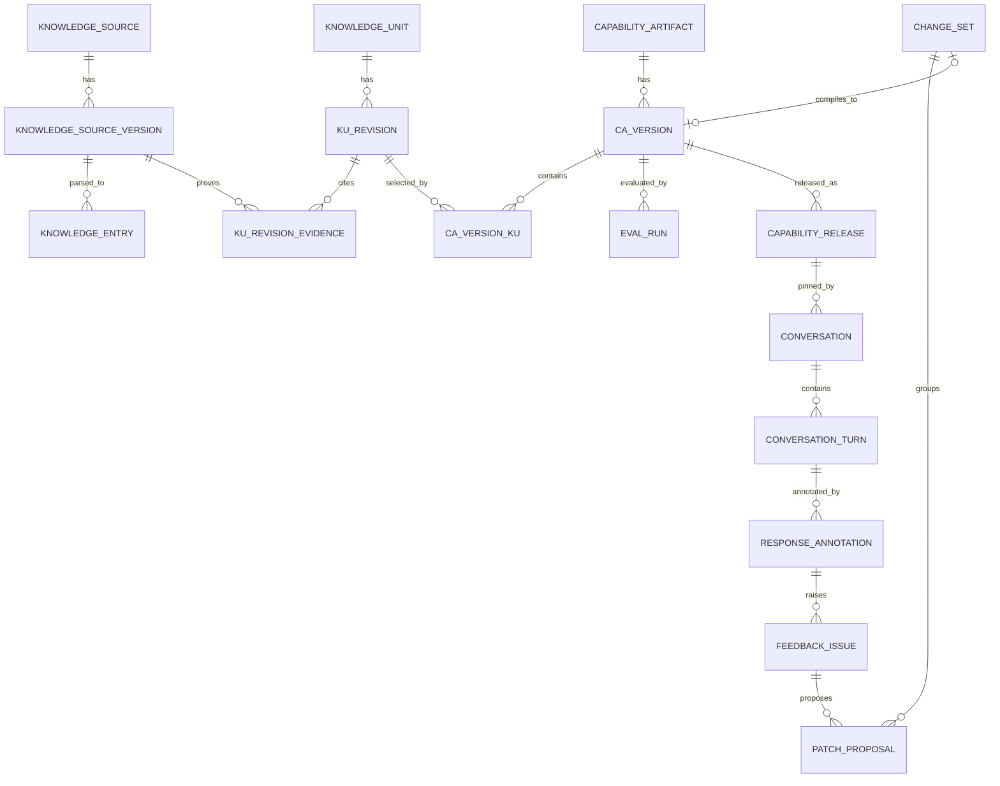

# 小飞 KU → CA 治理与版本实施方案（Mastra + LangGraph）

> 状态：当前实施基线<br>
> 更新日期：2026-08-03<br>
> 技术路线：TypeScript + Mastra + LangGraph + Neon/PostgreSQL<br>
> 范围：知识基线、商户导入、质量反馈、KU/CA 版本、Sandbox、逐句修正、Eval、发布与存储

配套演示文稿：
[`xiaofei-ku-ca-governance-storage-implementation.pptx`](./xiaofei-ku-ca-governance-storage-implementation.pptx)

本文是当前开始实施时的主参考方案。它保留完整的知识治理与用户调优闭环，但不引入
Parlant，也不要求第一阶段把所有中间对象都拆成独立版本表。

## 1. 需要解决的问题

系统不仅要完成文档 → KU → CA，还要支持：

1. 平台先用案例、历史会话和业务文档建立知识与能力基线；
2. 商户导入自己的知识库后，系统判断知识质量并提出需要商户参与的问题；
3. 商户确认事实、例外、权限、适用范围和转人工边界；
4. 形成可审核、可复用、可持续迭代的 KU；
5. 将确定的 KU 组合成可运行、可测试的 CA；
6. 给商户提供真实多轮 Sandbox 测试；
7. 对某一轮、某一句回答标注问题并生成修正建议；
8. 任何修改都能看到影响范围、前后差异和回归结果；
9. 发布后可以复现、灰度和回滚，不能直接覆盖线上能力。

## 2. 核心结论

### 2.1 三层版本模型必须保留

```text
可编辑 Draft
  → 提交审核时生成不可变 Revision / Version
  → 评测和审批后生成 Release
```

- Draft 用于持续编辑，不需要每次保存都产生正式版本；
- KU Revision 固定一次知识审核结果；
- CA Version 固定一次完整能力组合和运行配置；
- Release 固定一次上线、灰度和回滚记录。

只做 Release Snapshot 不够，因为用户需要单独查看 KU 的变化、来源、审核记录和影响范围。
但也不需要给 Slot、Prompt、Guardrail、Tool 等每个子对象单独建立 Revision 表，它们可以
先作为 CA Version Manifest 的一部分统一版本化。

### 2.2 Mastra 与 LangGraph 的职责不变

| 组件                       | 负责什么                                                        | 不负责什么                                   |
| -------------------------- | --------------------------------------------------------------- | -------------------------------------------- |
| `@repo/xiaofei`            | KU、CA、版本、Owner、Guardrail、Handoff、发布门禁和 Trace 契约  | 不依赖 Mastra、LangGraph、数据库或渠道 SDK   |
| Mastra Governance Workflow | 导入后的质量诊断、KU 候选生成、CA 编译检查、Eval 调度和修改建议 | 不直接决定线上发送资格                       |
| LangGraph                  | 多轮会话状态、Slot 收集、分支、重试、终止和转人工流程           | 不持有知识版本和发布状态                     |
| Mastra Agent               | 根据已准入 KU 和 CA 策略生成候选回复                            | 不改变 Owner，不直接发送消息或执行高风险动作 |
| Neon/PostgreSQL            | 版本关系、审核、反馈、发布和会话在线状态                        | 不保存大型原始文件和长期分析明细             |

### 2.3 运行时只读取确定版本

运行时禁止查询最新 KU 或当前 Draft。会话创建时固定 `capabilityReleaseId`，Release
再指向确定的 CA Version 和 KU Revision 集合。

```text
Conversation
  → Capability Release
      → CA Version
          → KU Revision A
          → KU Revision B
          → KU Revision C
```

### 2.4 实施时遵守四条边界

1. **逻辑身份与版本分开**：`kuId` / `caId` 用来持续讨论同一个业务对象，Revision / Version
   用来复现某一次确定内容；
2. **编辑与运行分开**：Draft 可以反复保存，运行、Eval 和 Release 只能引用不可变版本；
3. **事实与派生数据分开**：Source Version、KU Revision、CA Version 和 Release 是事实源，向量、
   摘要、分数和模型建议都可以重建；
4. **反馈与线上修改分开**：任何质量问题或逐句反馈先进入 Issue / Patch / ChangeSet，再产生新版本，
   不直接修改已发布对象。

## 3. 对象和版本关系

| 对象                | 长期身份            | 可编辑内容                     | 不可变版本                   | 运行时是否直接使用         |
| ------------------- | ------------------- | ------------------------------ | ---------------------------- | -------------------------- |
| Knowledge Source    | `sourceId`          | 当前来源配置                   | Source Version               | 通过 KU 证据间接使用       |
| Knowledge Entry     | `entryId`           | 当前规范化问答/条目            | 第一阶段不单独建 Revision    | 否                         |
| Knowledge Unit      | `kuId`              | KU Draft                       | KU Revision                  | 是，由 CA Version 确定引用 |
| Capability Artifact | `caId`              | CA Draft / 当前 CapabilityPlan | CA Version                   | 是，由 Release 确定引用    |
| Eval Dataset        | `datasetId`         | Case Draft                     | Eval Dataset Version         | 发布门禁使用               |
| Capability Release  | `releaseId`         | 不可编辑                       | 自身即不可变发布记录         | 是                         |
| Active Binding      | Agent/租户/渠道范围 | 当前指针                       | 通过 bindingVersion 并发控制 | 是                         |

### 3.1 什么时候生成正式版本

| 操作                       | 是否产生正式版本                                |
| -------------------------- | ----------------------------------------------- |
| 用户在编辑页保存 KU        | 否，只更新 Draft 和 Audit Event                 |
| 用户提交 KU 审核           | 是，生成 KU Revision                            |
| 审核驳回后继续编辑         | 否，继续修改 Draft                              |
| KU 审核通过                | 不修改 Revision，只更新审核状态                 |
| 组合 KU 并点击生成候选能力 | 是，生成 CA Version                             |
| 修改 Candidate 后再次测试  | 是，生成新的 CA Version                         |
| 运行一次 Eval              | 不生成 CA Version，Eval Run 绑定已有 CA Version |
| 发布                       | 生成 Capability Release，引用已有 CA Version    |

### 3.2 对象状态机

状态只描述治理进度，不能代替版本关系。内容不可变与状态可迁移并不冲突：Revision / Version
的 payload、hash、依赖和 schema 不可修改，审核状态通过受控命令更新，并追加 Audit Event。

```text
Source Version
  parsing → diagnosing → action_required → ready → archived
                      └───────────→ failed

Knowledge Quality Issue
  open → acknowledged → resolving → resolved
                    └─────────→ waived（必须记录原因和审批人）

KU Draft
  editing ↔ review_ready
               └─ submit → KU Revision[pending]
                                ├─ approve → approved
                                └─ reject  → rejected → 回到 Draft

CA Version
  candidate → evaluating → review_ready → approved → released
                       └── failed ─────────────┘

Release
  candidate → shadow → assist → active → suspended / retired
```

`stale` 是来源谱系状态，不等于删除或自动下线。旧 Revision 仍需供历史 Release 复现；新 CA
编译默认不能选择 stale Revision。若属于严重安全事实变化，再通过单独的紧急停用流程暂停 Release。

### 3.3 三个原子操作

| 原子操作         | 同一事务内完成                                                                                             | 并发控制                                     |
| ---------------- | ---------------------------------------------------------------------------------------------------------- | -------------------------------------------- |
| 提交 KU Revision | 校验 Draft、关闭阻塞 Issue、锁定 `baseRevisionId`、规范化 JSON、计算 hash、创建 Revision、记录证据和 Audit | `draftVersion` + `(kuId, revision)` 唯一约束 |
| 编译 CA Version  | 校验 KU 审核状态、展开 Baseline/Overlay、执行冲突检查、创建 Version、关系行和 Manifest                     | `baseVersionId` + Manifest hash 去重         |
| 激活 Release     | 校验 Eval/审批、创建 Release、切换 Binding、保留 previousReleaseId、写 Outbox                              | `bindingVersion` 乐观锁                      |

事务中只写确定结果；Mastra 生成、模型评审、Embedding 和大型 Eval 在事务外运行，通过任务状态和幂等键回写，
避免长事务占用数据库连接。

## 4. 完整业务流程

### 4.1 一条主流程、两个反馈入口

```text
                                 ┌─ 知识质量反馈 ─→ KU Draft ─┐
来源/案例 → Source Version → Entry → KU Revision → CA Version → Sandbox/Eval → Release
                                 └─ 会话逐句反馈 ─→ 根因定位 ─→ Patch/ChangeSet ─┘
```

两个入口最终都回到 Draft，但回到哪个 Draft 由根因决定：事实与适用范围问题修改 KU Draft；
路由、状态、工具和回复策略问题修改 CA Draft；测试预期错误则只修改 Eval Dataset Draft。

### 4.2 阶段输入、产物和门禁

| 阶段       | 主要输入                             | 持久化产物                                  | 进入下一阶段的门禁                         |
| ---------- | ------------------------------------ | ------------------------------------------- | ------------------------------------------ |
| 采集       | 文件、网页、Q&A、历史会话、人工结果  | Import Batch、Source Version、原始对象引用  | 文件可读、hash 完成、租户和来源可追溯      |
| 解析       | Source Version                       | Entry、Evidence Span、解析报告              | 关键段落可定位，解析失败项已处理           |
| 诊断       | Entry、平台规则、冲突与覆盖扫描      | Knowledge Quality Issue、自动修复 Diff      | `user_required` 和 KU Blocker 已关闭       |
| KU 治理    | Entry、证据、商户补充、平台模板      | KU Draft、KU Revision、Review/Audit         | Revision approved、lineage current         |
| CA 编译    | Approved KU Revision、基线、运行策略 | CA Version、KU 关系、Manifest、编译报告     | 无冲突、Schema 兼容、所需 Eval 已绑定      |
| 验证       | CA Version、测试集、Sandbox 会话     | Eval Run、TestTurn、Annotation、Patch       | 硬门禁通过、回归可接受、用户验收           |
| 发布       | Approved CA Version、Eval、审批      | Release、Active Binding、Outbox             | 激活事务成功，可回滚指针已保存             |
| 运行与学习 | 固定 Release 的真实会话              | Turn、State Snapshot、Trace、线上反馈与指标 | 反馈只生成候选修改，不直接改变当前 Release |

### 4.3 平台建立知识与能力基线

```text
代表性业务文档 + 历史会话 + 正确回答 + 错误回答 + 人工处理结果
  → Source Version
  → 解析和规范化 Entry
  → 知识质量诊断
  → 平台补充事实、例外、权限和风险边界
  → KU Draft
  → KU 审核并生成 Approved KU Revision
  → 组合为 Baseline CA Version
  → 固定基准、风险反例和多轮 Eval
  → Baseline Release
```

基线应提供：

- 通用业务概念、场景和风险边界；
- 可复用的 KU 结构模板；
- 通用 LangGraph 流程模板和状态契约；
- 不允许商户绕过的 Guardrail 与安全 Eval；
- 商户导入后进行对比的基准结果。

### 4.4 商户导入知识库

```text
选择平台 Baseline Release
  → 上传文件、网页或手工 Q&A
  → 保存不可变 Source Version 和证据位置
  → 解析为 Entry
  → 生成 Knowledge Quality Issue
  → 自动修复确定性问题
  → 商户确认事实、冲突、例外、权限和责任边界
  → 生成或更新 KU Draft
  → 商户审核 KU Revision
  → 平台基线 + 商户 KU Revision 编译 Tenant CA Version
```

导入完成不代表可以上线。只有阻塞质量问题已经处理、KU 已审核、CA 已评测，才可以
形成候选 Release。

商户导入批次建议按以下规则处理：

- 相同内容 hash 重复上传时复用已有 Source Version，不重复生成 KU；
- 同一来源内容变化时生成新 Source Version，不覆盖旧版本；
- 解析结果先进入 Entry 和 Issue，不直接生成可发布 KU；
- 商户确认产生结构化补充或 Patch，不只保存一段聊天式说明；
- 一个导入批次可以影响多个 KU，但必须能从每个 KU Revision 反查到原始证据。

### 4.5 Sandbox 与逐句修正

```text
选择一个 CA Version
  → 创建 Sandbox Session
  → 运行真实多轮对话，但禁用真实副作用
  → 保存每轮输入、状态、KU、CA、Trace 和回答
  → 用户标注整轮或某一句
  → 系统判断根因层
  → 生成 Patch Proposal
  → 用户接受、编辑或拒绝
  → 更新对应 Draft
  → 生成新 KU Revision / CA Version
  → 对比旧版与新版并重新 Eval
```

逐句反馈不能直接修改线上版本，也不能简单把用户给出的正确回答复制成新知识。

逐句反馈的处理顺序固定为：

1. 用 `turnId + responseHash + startOffset/endOffset` 固定用户看到的原回答；
2. 读取该轮实际命中的 KU Revision、LangGraph 状态变化、Mastra Prompt/模型和 Guardrail 结果；
3. 先判断“知识是否正确”，再判断“选取是否正确”，最后判断“生成是否正确”；
4. 生成一个或多个 Patch Proposal，分别指向 Source、KU、CA 或 Eval Case；
5. 用户接受后只更新 Draft，并把 Patch 放入 ChangeSet；
6. ChangeSet 编译出新候选版本，运行目标 Case 和受影响 Case，再运行发布硬门禁。

### 4.6 发布与持续调优

```text
质量问题或会话反馈
  → ChangeSet
  → 新 KU Revision / CA Version
  → 影响分析
  → 目标 Case + 商户 Golden Case + 平台安全基准
  → 新旧回答与状态对比
  → 用户验收和审批
  → Capability Release
  → Shadow / Assist / Limited Auto
  → 指标监控或回滚
```

线上观察到的问题按相同闭环处理。区别只在于生产反馈必须带 `releaseId`、`turnId` 和渠道消息 ID，
并经过脱敏与租户校验；它不能把“线上某次回答”自动变成知识事实。

## 5. 知识质量治理

每个质量问题必须有类别、证据、严重级别、责任人、建议和发布影响，不能只给一个总分。

| 类别       | 示例                             | 默认处理            |
| ---------- | -------------------------------- | ------------------- |
| 解析质量   | 乱码、空段、表格错列、OCR 错误   | 自动修复，展示 Diff |
| 可追溯性   | 找不到原文位置、来源失效         | 阻塞对应 KU 审核    |
| 事实完整性 | 缺适用条件、时效、例外           | 要求商户补充        |
| 事实冲突   | 两份文档对退款时限描述不同       | 商户确认权威来源    |
| 歧义       | 尽快、特殊情况等无判断标准       | 建议改为可执行条件  |
| 权限与风险 | 可退款但没有金额、角色或审批边界 | 阻塞自动执行能力    |
| 流程完整性 | 要求收集资料但缺完成或退出条件   | 阻塞对应 CA         |
| 可测试性   | 无法形成输入、预期动作或结果     | 要求补充正例和反例  |
| 覆盖度     | 高频问题无知识或无测试           | 警告或阻塞指定能力  |

处理级别：

- `auto_fix`：系统可确定处理，用户查看 Diff；
- `suggest`：系统给候选方案，用户接受、编辑或拒绝；
- `user_required`：必须由商户补充或确认；
- `release_blocker`：未关闭前不得生成可发布 CA。

建议的数据结构：

```text
KnowledgeQualityIssue
  id / workspaceId / importBatchId
  targetType / targetId / targetVersion
  category / severity / handlingMode
  evidence / description / suggestedPatch
  status / assignee
  blocksKuReview / blocksCaRelease
  createdAt / resolvedAt / resolvedBy
```

`blocksKuReview` 和 `blocksCaRelease` 必须作为可查询列，不要只埋在 JSON 中。Issue 的证据、
建议 Patch 和模型解释可以放 JSONB；类别、状态、严重度、责任人和门禁字段使用普通列，便于列表、
统计和事务内判断。

关闭 Issue 时必须保存 `resolutionType`、最终修改、证据和操作者。`waived` 只能由有权限的角色执行，
并且不会消除历史问题；CA Compiler 可以根据类别决定是否仍然阻塞高风险能力。

## 6. KU 数据结构与版本

### 6.1 逻辑对象和 Draft

```text
KnowledgeUnit
  id / workspaceId / code
  currentDraft          当前可编辑 JSON
  draftHash
  draftVersion          乐观锁版本
  baseRevisionId        Draft 从哪个 Revision 派生
  draftStatus           editing / review_ready
  lifecycleStatus       active / archived
  updatedBy / updatedAt
```

`KnowledgeUnit` 是长期身份，不保存“当前线上版本”语义。当前线上使用哪个 KU Revision 由 CA Version
决定，编辑页默认展示哪个 Revision 由 `baseRevisionId` 和 Draft 决定。

### 6.2 不可变 Revision

```text
KnowledgeUnitRevision
  id / knowledgeUnitId
  revision              单调递增
  parentRevisionId
  contentHash
  schemaVersion
  content               完整 KU 内容
  sourceEvidence        Source Version、Entry 和原文位置快照
  reviewStatus
  lineageStatus         current / stale
  createdBy / createdAt
  reviewedBy / reviewedAt
```

Revision 的 `content`、`contentHash`、`schemaVersion`、`parentRevisionId` 和证据快照一旦生成不得修改；
`reviewStatus`、`lineageStatus` 和审核时间只允许通过状态迁移命令更新，并追加 `GovernanceAuditEvent`。
来源变化时可以把 lineage 标记为 stale，但旧 Revision 仍然保留给历史 CA、Release、Eval 和 Trace 使用。

建议将证据关系单独保存，避免只靠 JSON 无法反查影响范围：

```text
KnowledgeUnitRevisionEvidence
  knowledgeUnitRevisionId
  sourceVersionId
  entryId / entryVersion
  evidencePath          页码、标题路径、表格/段落或字符范围
  quoteHash
  evidenceSnapshot      必要的规范化文本快照
```

Entry 第一阶段不单独建 Revision 表，因此 KU Revision 必须保存 `entryVersion + evidenceSnapshot`。
这样即使 Entry 后续被重新解析或删除，历史 CA 仍可解释当时依据的内容。

### 6.3 KU 内容建议

```text
KU Content
  title
  scope
    intents / applicableScenarios / inapplicableScenarios
    audiences / channels / locales
  knowledge
    facts / policies / procedures
    examples / counterExamples
  requiredSlots
    key / type / required / askText / validationRule
  responsePolicy
    requiredClaims / forbiddenClaims / styleHints / fallbackReply
  actionBoundary
    allowed / forbidden / approvalRequired
  handoffRules
    conditions / requiredContext
  lineage
    sourceVersionIds / entryIds / evidenceRefs
```

KU 保存可复用的知识、适用条件、输入和安全约束。多个 KU 的组合优先级、完整会话流程、
工具编排和 Agent 级策略属于 CA。

### 6.4 同一 KU 还是新建 KU

以下情况创建同一 `kuId` 的新 Revision：修正事实、补充例外、调整适用范围、Slot、回复约束或证据。
以下情况创建新 `kuId`：业务责任人不同、发布生命周期需要独立、两个规则需要同时存在并由条件选择，
或新内容与原 KU 不再表达同一个业务能力。拆分和合并需要在 Audit Event 中记录 `supersedesKuIds`，
但第一阶段不需要实现复杂版本图。

### 6.5 提交 Revision 的确定规则

1. 校验提交者看到的 `draftVersion` 和 `baseRevisionId` 仍是当前值；
2. 使用固定字段顺序、去除无意义空值的 Canonical JSON 计算 `contentHash`；
3. 相同 `kuId + contentHash` 已存在时返回现有 Revision，保证重复请求幂等；
4. 复制完整 KU Content 和 Evidence Snapshot，不只保存 Diff；
5. 创建 `pending` Revision 后锁定本次审核内容，后续修改继续进入 Draft；
6. 审核通过只改变状态；若审核意见要求改内容，必须拒绝并重新提交新 Revision。

## 7. CA 数据结构与版本

### 7.1 CA Draft

当前 `CapabilityPlan` 继续作为 CA Draft 的兼容模型，不需要第一阶段重写现有页面和 API。

```text
CapabilityArtifact
  id / workspaceId / code / name
  currentDraft
  draftHash
  draftVersion
  baseVersionId
  lifecycleStatus
  updatedBy / updatedAt
```

CA Draft 至少包含：

- 选用哪些 Approved KU Revision；
- KU 的 role、priority、覆盖和冲突处理；
- LangGraph 模板和参数；
- ConversationState Schema 版本；
- Mastra Agent 指令和生成策略；
- 检索、Tool、Guardrail、Handoff 和回复策略；
- 平台基线和商户覆盖信息；
- 需要运行的 Eval Dataset Version。

### 7.2 不可变 CA Version

```text
CapabilityArtifactVersion
  id / capabilityArtifactId
  version / parentVersionId
  baseReleaseId
  schemaVersion / compilerVersion
  manifestHash
  manifest
  status
    candidate / evaluating / review_ready / failed / approved / superseded
  createdBy / createdAt
```

与 KU 相同，Version 的 Manifest、hash、依赖和编译器版本不可修改；评测与审核状态可以迁移，
但每次迁移都记录 Audit Event。一个 CA Version 可以运行多次 Eval，不需要因为模型重复运行而产生新 Version。

CA Version 与 KU Revision 的确定关系：

```text
CapabilityVersionKnowledgeUnit
  capabilityVersionId
  knowledgeUnitRevisionId
  role                  primary / supporting / exception / safety / fallback
  priority
  conflictPolicy
  enabled
```

### 7.3 CA Manifest

```text
Capability Manifest
  schemaVersion / compilerVersion
  capabilityCode / baseReleaseId
  knowledgeUnits
    kuRevisionId / contentHash / role / priority
  langGraphPolicy
    graphTemplateVersion / stateSchemaVersion / flowParameters
  mastraPolicy
    agentTemplateVersion / instructionHash / generationProfile
  retrievalPolicy
  toolPolicy
  guardrailPolicy
  responsePolicy
  evalDatasetVersionIds
  compatibility
```

Manifest 可以保存不可变引用，也可以嵌入 KU 内容快照。无论采用哪种方式，运行时都不能
解析最新 KU。

建议采用“关系表用于查询 + Manifest 用于完整运行快照”的双写方式：关系表支持影响分析和权限查询，
Manifest 支持一次加载、hash 校验和历史复现。两者在同一编译事务中生成，Manifest 中的 KU 列表与
`CapabilityVersionKnowledgeUnit` 必须完全一致。

### 7.4 编译检查

KU → CA Compiler 至少检查：

- 所有 KU Revision 已审核且来源仍可用；
- 场景重叠是否有优先级或冲突策略；
- 事实、时效和政策是否冲突；
- Slot 是否重名、类型不一致或退出条件缺失；
- Action 允许与禁止是否矛盾；
- 必需 Tool 是否存在并满足风险策略；
- Handoff 是否可能被其他路由覆盖；
- LangGraph 模板是否与 State Schema 兼容；
- Mastra 输入是否只包含已准入知识；
- Eval 是否覆盖新增场景、例外和风险边界。

### 7.5 编译与影响分析

编译器输入是明确的 KU Revision ID、Baseline Release、CA Draft 和运行模板版本。输出包括：

- 完整 Manifest 与 `manifestHash`；
- CA Version → KU Revision 关系；
- 编译诊断：冲突、缺 Slot、缺 Tool、无退出路径、Schema 不兼容；
- 影响集合：受影响的 CA、Eval Case、Baseline/商户覆盖和当前 Release；
- 推荐回归集合：直接关联 Case + 同场景/同 Slot/同 Guardrail Case + 平台安全集。

KU 更新不会自动修改任何 CA Version，只会将引用旧 Revision 的未发布候选标记为“有可用更新”，
并为相关 CA Draft 提供升级建议。是否生成新 CA Version 由用户或治理 Workflow 明确触发。

## 8. 平台基线与商户覆盖

商户不应复制平台全量知识后独立漂移。建议保存组合关系，发布时编译成完整 Manifest。

```text
Tenant CA Candidate
  = Platform Baseline Release
  + Tenant KU Revision Overlay
  + Tenant CA Policy Overlay
  - Explicitly Disabled Baseline KU
```

规则：

- 平台强制安全 KU、Guardrail 和安全 Eval 不允许商户禁用；
- 商户覆盖只在明确业务范围内高于平台通用知识；
- 平台基线升级只生成 Upgrade Candidate，不静默改变商户线上 Release；
- 商户完成差异确认和回归后才更新 `baseReleaseId`；
- 发布时将基线和覆盖层展开，运行时不做动态 Overlay 合并。

## 9. Eval、Sandbox 和逐句反馈

### 9.1 Eval 分层

| 层次           | 检查内容                             | 实现方式                   |
| -------------- | ------------------------------------ | -------------------------- |
| 结构与版本     | Schema、hash、lineage、Manifest 依赖 | TypeScript 确定性断言      |
| KU 选择        | 正确 KU、例外、优先级和知识缺失      | 固定输入与预期 KU Revision |
| LangGraph 状态 | 追问、Slot、冲突、终止、Handoff      | 多轮脚本重放               |
| Mastra 回答    | 事实、完整性、相关性、语气           | 规则 + 模型评审 + 人工抽样 |
| 安全           | 越权承诺、提示注入、风险动作         | 强制反例集                 |
| 线上效果       | 接管率、人工修改率、一次解决率       | Shadow / Assist 指标       |

模型评审只能作为证据，不能单独决定事实、权限、Owner、Action 和 Handoff 是否通过。

### 9.2 Eval 数据

```text
EvalDataset
  id / workspaceId / currentDraft

EvalDatasetVersion
  id / datasetId / version / contentHash
  casesSnapshot / createdAt

EvalRun
  id / capabilityVersionId
  datasetVersionIds
  runtimeVersion / graphVersion / modelProfile
  baselineRunId
  status / metrics / regressionSummary

EvalRunCaseResult
  evalRunId / caseId
  passed / severity
  expected / actual
  stateDiff / knowledgeDiff / traceRef
```

### 9.3 Sandbox 与反馈

```text
SandboxSession
  id / workspaceId / candidateCapabilityVersionId
  comparisonReleaseId / createdBy

TestConversation
  id / sandboxSessionId / state / status

TestTurn
  id / conversationId / turnIndex
  input / output / stateBefore / stateAfter
  capabilityVersionId / kuRevisionIds
  decisionTraceRef / modelRunId

ResponseAnnotation
  id / turnId / responseHash
  sentenceId / startOffset / endOffset / quotedText
  category / severity / expectedBehavior / comment

FeedbackIssue
  id / annotationId
  rootCauseLayer / targetLogicalId
  status / assignee

PatchProposal
  id / feedbackIssueId
  targetType / targetId
  patch / reason / evidence
  source             system / user
  status             proposed / accepted / edited / rejected

ChangeSet
  id / workspaceId / title / status
  patchProposalIds
  candidateCapabilityVersionId
```

`ResponseAnnotation` 必须保留原回答 hash 和文本范围。若候选版本重新生成回答，旧标注继续指向旧 Turn，
不能尝试把 offset 自动套用到新文本；比较页通过 Patch 和 Case 关系展示前后变化。

`FeedbackIssue` 可以关联多个 Annotation，一个 Annotation 也可能拆出多个 Patch。第一阶段可通过关联表实现，
不要将 `patchProposalIds` 作为唯一事实只存进 JSON 数组。

反馈根因层至少包括：

- `source`：原始事实错误或过期；
- `ku`：适用范围、事实、例外、Slot 或禁止项错误；
- `ca_routing`：选错 KU、优先级或冲突策略；
- `langgraph_flow`：追问、回退、终止或 Handoff 时机错误；
- `mastra_generation`：知识正确但组合、表达或格式错误；
- `guardrail_tool`：权限、动作或发送边界错误；
- `eval_case`：用户提供的预期本身错误。

### 9.4 从反馈到回归的门禁

| 根因             | 修改对象              | 最小回归范围                                       |
| ---------------- | --------------------- | -------------------------------------------------- |
| Source / KU 事实 | Source 或 KU Draft    | 原问题、同 KU、引用该 KU 的 CA、平台安全 Case      |
| CA 路由 / 优先级 | CA Draft              | 冲突 KU、同场景、多轮路由和 Handoff Case           |
| LangGraph 状态   | CA Draft / Graph 参数 | 同 State Schema 的多轮脚本、退出和重试 Case        |
| Mastra 生成策略  | CA Draft / Policy     | 事实一致性、格式、风格及不可承诺项                 |
| Guardrail / Tool | CA Draft / Policy     | 强制安全反例、审批、Owner 和副作用隔离             |
| Eval 预期错误    | Eval Dataset Draft    | 该 Case 审核；不要求生成新的 KU/CA，除非依赖也变化 |

目标 Case 通过不代表可以发布。发布候选仍要跑受影响集合、商户 Golden Case 和平台强制安全集。

## 10. Release、会话固定与回滚

```text
CapabilityRelease
  id / workspaceId
  capabilityVersionId
  manifestHash
  evalRunId / approvalId
  releaseNumber
  status
    candidate / shadow / assist / active / suspended / retired
  rolloutPolicy
  releasedAt / releasedBy

ActiveCapabilityBinding
  workspaceId / agentId / channel / scope
  activeReleaseId / previousReleaseId
  rolloutPercent / effectiveAt
  bindingVersion
```

ConversationState 增加：

```text
capabilityReleaseId
capabilityVersionId
stateSchemaVersion
knowledgeManifestHash
```

每轮 Trace 保存实际 `matchedKuRevisionIds`、LangGraph 状态变化、Mastra 运行版本、Tool、
Guardrail 和 Owner 证据。

同一会话默认固定 Release。新 Release 默认只作用于新会话；严重安全问题可以暂停旧
Release、强制 Handoff，或通过显式迁移规则切换。回滚只切换 Binding，不删除旧版本。

### 10.1 发布门禁

| 门禁       | 硬性要求                                                         |
| ---------- | ---------------------------------------------------------------- |
| 版本完整性 | Manifest hash 一致，所有 KU Revision 存在且 approved             |
| 知识质量   | CA 范围内 `release_blocker` 已关闭，无未审批 waiver              |
| 确定性规则 | Schema、Slot、Tool、Guardrail、Handoff 和 Owner 断言通过         |
| 回归       | 目标 Case、受影响 Case、商户 Golden Case 和平台安全集满足阈值    |
| 人工验收   | 指定审批人确认 Diff、风险和回滚目标                              |
| 可运行性   | Graph/State Schema/Mastra Policy 兼容，依赖工具健康              |
| 可回滚性   | previousReleaseId 可用，Binding 更新使用 expected bindingVersion |

### 10.2 会话固定规则

创建会话时，API 先按 `workspaceId + agentId + channel + scope` 解析 Active Binding，然后把
`releaseId`、`capabilityVersionId`、`manifestHash` 和 `stateSchemaVersion` 写入会话行和状态快照。
后续每一轮只使用这组固定值。LangGraph checkpoint 可以用于技术恢复，但不能成为唯一业务事实源；
Owner、Slot、Handoff 和版本固定仍以领域 `ConversationState` 为准。

## 11. 存储方式

### 11.1 四层存储结构

```text
┌── 事实与在线状态：Neon / PostgreSQL ──────────────────────────┐
│ 版本关系、审核门禁、Release、Binding、ConversationState、索引元数据 │
└──────────────────────────────────────────────────────────┘
                  │ objectRef / hash       │ CDC / ETL
                  ▼                        ▼
┌── 大对象存储 ───────────┐   ┌── 分析与冷数据 ────────────────┐
│ 原始文件 / 网页快照      │   │ 长期会话、效果指标、人工修改 │
│ 大 Trace / Eval / 模型响应 │   │ 跨版本趋势与离线调优数据     │
└───────────────────────┘   └──────────────────────────────┘
                  │
                  ▼
┌── 可重建检索层：全文 / Vector / Rerank ─────────────────┐
│ 必须携带 workspaceId + capabilityVersionId + kuRevisionId + modelVersion │
└──────────────────────────────────────────────────────────────────────┘
```

PostgreSQL 是治理关系和在线状态的事实源；对象存储保存体积大、读取频率低或需要原样留存的内容；
检索层与分析层都是派生数据，丢失后可以由确定版本重建。

### 11.2 PostgreSQL 表分组

| 分组       | 核心表                                                                                                   | 主要职责                                 |
| ---------- | -------------------------------------------------------------------------------------------------------- | ---------------------------------------- |
| 来源与证据 | `ImportBatch`、`KnowledgeSource`、`KnowledgeSourceVersion`、`KnowledgeEntry`、`EvidenceRef`              | 固定原始版本、解析结果和证据位置         |
| 知识治理   | `KnowledgeQualityIssue`、`KnowledgeUnit`、`KnowledgeUnitRevision`、`KuRevisionEvidence`、`AuditEvent`    | Draft、审核、谱系和质量门禁              |
| 能力与版本 | `CapabilityArtifact`、`CapabilityArtifactVersion`、`CapabilityVersionKnowledgeUnit`                      | CA Draft、Manifest 和确定 KU 组合        |
| 验证与反馈 | `EvalDatasetVersion`、`EvalRun`、`EvalRunCaseResult`、`SandboxSession`、`TestTurn`、`ResponseAnnotation` | 测试证据、逐句问题和前后对比             |
| 修改治理   | `FeedbackIssue`、`PatchProposal`、`ChangeSet` 及关联表                                                   | 根因、修改建议、用户选择和候选版本       |
| 发布与运行 | `CapabilityRelease`、`ActiveCapabilityBinding`、`Conversation`、`ConversationTurn`、`TraceIndex`         | 发布指针、固定版本、在线状态和可追溯运行 |

### 11.3 核心关系



关系 ID、租户、版本、状态、hash、时间、门禁和排序字段使用普通列；KU Content、CA Manifest、
ConversationState、Diff、模型建议和小型 Trace payload 使用 JSONB；大型原文和完整模型 I/O 使用 objectRef。
身份关系不要只放 JSON 数组，否则无法可靠做外键、影响分析和租户隔离。

### 11.4 建议的关键约束与索引

```text
unique(workspaceId, knowledgeUnit.code)
unique(knowledgeUnitId, revision)
unique(knowledgeUnitId, contentHash)
unique(workspaceId, capabilityArtifact.code)
unique(capabilityArtifactId, version)
unique(capabilityArtifactId, manifestHash)
unique(capabilityVersionId, knowledgeUnitRevisionId)
unique(workspaceId, agentId, channel, scope)       -- Active Binding
unique(workspaceId, externalConversationId)
unique(conversationId, turnIndex)
```

常用索引：

- `KnowledgeQualityIssue(workspaceId, status, blocksCaRelease, severity)`；
- `KnowledgeUnitRevision(knowledgeUnitId, reviewStatus, lineageStatus)`；
- `CapabilityVersionKnowledgeUnit(knowledgeUnitRevisionId)`，用于反查影响 CA；
- `CapabilityRelease(workspaceId, status, releasedAt)`；
- `Conversation(workspaceId, status, updatedAt)`；
- `ConversationTurn(conversationId, createdAt)` 和 `ResponseAnnotation(turnId)`。

所有租户数据查询都带 `workspaceId`。延续当前 Prisma 边界的 `@@unique([workspaceId, id])` 与复合 selector，
让跨租户 ID 在查询层表现为不存在，而不是先查出再判断。

### 11.5 ConversationState 与会话数据

会话量大时，不建议继续把所有消息和 Trace 追加到一行 JSON。目标结构为：

```text
Conversation
  workspaceId / externalConversationId / status
  capabilityReleaseId / capabilityVersionId / manifestHash
  stateSchemaVersion / stateVersion / ownerEpoch
  currentState JSONB
  lastTurnId / lastMessageAt

ConversationTurn
  conversationId / turnIndex / inboundMessageId / idempotencyKey
  inputText / outputText
  stateBeforeHash / stateAfterHash / stateAfterSnapshot(optional)
  matchedKuRevisionIds / nextAction / ownerEpoch
  modelRunId / traceObjectRef / createdAt

TraceIndex
  turnId / eventType / severity / summary / objectRef
```

- `Conversation.currentState` 是快速恢复的当前快照，通过 `stateVersion` 乐观锁更新；
- `ConversationTurn` 是追加式历史，消息幂等键避免消息源重复投递造成重复回复；
- 每轮可以保存 state diff 或周期性完整 checkpoint，大型 Trace 放对象存储；
- 常用筛选字段，如 owner、stage、nextAction、releaseId，放列或维护投影，不只存在 JSONB；
- LangGraph checkpoint 只用于工作流恢复，可以重建，不能替代领域状态和 Turn 历史。

当前 `XiaofeiConversation.state/messages/traceEvents` JSON 设计可继续支撑 P0；迁移时先新增版本固定列和
`ConversationTurn` 双写，验证后再停止向 `messages`、`traceEvents` 数组追加，避免一次性迁移风险。

### 11.6 对象存储与内容寻址

保存原始文件、网页快照、Markdown、表格、图片、OCR、大型 Prompt Render、模型原始响应、完整 Trace、
大型 Eval 输入输出和长期会话归档。对象键不使用“当前版本”路径覆盖，而使用内容 hash 或不可变 ID。

数据库保存 `objectRef`、`contentHash`、MIME、大小、加密/租户信息和保留策略。被 KU Revision、CA Version、
Eval 或历史 Release 引用的对象在引用有效期间不能物理删除；用户删除先做逻辑删除和引用检查。

### 11.7 搜索与向量索引

```text
workspaceId + capabilityVersionId + kuRevisionId + embeddingModelVersion
```

检索索引只从 Approved KU Revision 或已编译 Manifest 生成。查询必须先按 Workspace 和当前 CA Version
过滤，再做全文、向量和 Rerank；结果必须返回确切的 KU Revision 与 EvidenceRef。发布时为候选版本预建索引，
激活只切 Binding；回滚无需重嵌入。索引任务使用 `manifestHash + embeddingModelVersion` 作为幂等键。

### 11.8 分析、归档与删除

长期会话、用户反馈、人工修改和效果指标通过 CDC/ETL 进入分析存储。在线 PostgreSQL 不承担跨月全量分析。
保留期按数据类别配置：治理版本和发布证据长期保留；原始消息、PII、模型输入输出、Trace 和分析明细分别管理。
删除请求先解除在线访问，再处理对象与分析副本；用于合规审计的最小 hash、版本关系和删除记录可单独保留。

### 11.9 与当前 Prisma 模型的渐进迁移

| 当前模型/字段                        | 目标调整                                                                              |
| ------------------------------------ | ------------------------------------------------------------------------------------- |
| `XiaofeiKnowledgeDocument`           | 保留逻辑 Source，新增 `KnowledgeSourceVersion`；当前 body/hash/version 回填为首个版本 |
| `XiaofeiKnowledgeEntry.entryVersion` | 第一阶段保留；KU Revision 额外保存 Entry 版本与 Evidence Snapshot                     |
| `XiaofeiKnowledgeUnit.content`       | 迁入逻辑 KU 的 `currentDraft`，新增 Revision 表；历史已发布 KU 回填为 Revision 1      |
| Workspace `capabilityPlan` Snapshot  | 暂作 CA Draft 兼容入口，编译时写 `CapabilityArtifactVersion` 和关系表                 |
| `XiaofeiConversation.state`          | 增加 Release/CA/Schema 固定字段和 `stateVersion`；随后双写 `ConversationTurn`         |
| `messages` / `traceEvents` JSON 数组 | P0 保留，目标改为追加式 Turn/TraceIndex + 对象存储；完成校验后停止数组增长            |

迁移期间所有读取先兼容旧数据，所有新 Release 只从新版本表运行；不要让同一会话一部分读取 Snapshot、
一部分读取 CA Version。

## 12. 第一阶段必须落地的数据模型

为了满足完整需求，第一阶段不能只做 Release，但可以控制在以下核心实体：

1. 来源：`ImportBatch` + `KnowledgeSourceVersion`，沿用当前 Knowledge Entry；
2. 质量：`KnowledgeQualityIssue`；
3. KU：`KnowledgeUnit` + `KnowledgeUnitRevision` + `KuRevisionEvidence`；
4. CA：`CapabilityArtifact` + `CapabilityArtifactVersion` + `CapabilityVersionKnowledgeUnit`；
5. Eval：`EvalDatasetVersion` + `EvalRun` + `EvalRunCaseResult`；
6. Sandbox：`SandboxSession` + 可复用的 Conversation + `ConversationTurn`；
7. 反馈：`ResponseAnnotation` + `FeedbackIssue` + `PatchProposal` + 轻量 `ChangeSet` 及关联表；
8. 发布：`CapabilityRelease` + `ActiveCapabilityBinding`；
9. 审计与可靠投递：统一 `GovernanceAuditEvent` + `OutboxEvent`；
10. 当前 Conversation 增加 Release/CA/Schema 固定字段和 `stateVersion`。

不要求第一阶段一次实现分析仓库或独立向量服务，但版本、证据、关系、门禁、Turn 和发布指针不能省略，
否则无法完成影响分析、逐句反馈和运行复现。

### 12.1 可以精简和延后的内容

- Entry 第一阶段继续使用当前 `entryVersion`，KU Revision 保存 Entry 和证据快照；
- KU Draft 直接放在 `KnowledgeUnit.currentDraft`，不单独建 Draft 表；
- CA Draft 直接放在 `CapabilityArtifact.currentDraft`，不单独建 Draft 表；
- Slot、Prompt、Tool、Guardrail 不建独立 Revision，统一进入 CA Manifest；
- ChangeSet 只做修改分组、审批和候选关联，不实现分支、合并和 DAG；
- Sandbox Conversation 可以复用生产 Conversation 结构，只增加 environment 和版本字段；
- LangGraph 第一阶段使用代码定义的模板和版本，不做可视化图编辑器；
- Mastra 第一阶段继续使用现有 Agent/Workflow，不做多运行时抽象；
- Baseline Overlay 第一阶段先支持一个平台基线和一个商户覆盖层；
- 搜索第一阶段保留当前确定性匹配，接口稳定后再接向量和 Rerank；
- 分析仓库、自动灰度和复杂影响图在真实数据量出现后再建设。

## 13. 与当前代码的迁移顺序

### 阶段 A：KU Revision 与 CA Version

1. 给当前 Source 补 `KnowledgeSourceVersion` 和 Import Batch，确保原始证据不可变；
2. 将当前 `XiaofeiKnowledgeUnit` 变成逻辑 KU + currentDraft；
3. 增加 `KnowledgeUnitRevision` 和 Evidence 关系，提交审核时原子创建 Revision；
4. 保留当前 `CapabilityPlan` API，迁移为 `CapabilityArtifact.currentDraft`；
5. 增加确定性 CA Compiler、CA Version、Manifest Hash 和 KU Revision 依赖；
6. 当前审核和 Eval 失效逻辑改为基于内容 Hash，而不是仅使用时间版本号。

### 阶段 B：Release 与运行固定

1. 增加 Release 和 Active Binding；
2. LangGraph 运行前解析 Release，不再读取当前 Workspace Draft；
3. ConversationState 固定 Release、CA Version 和 State Schema；
4. 增加 ConversationTurn、stateVersion、消息幂等键和 Outbox；
5. 新版本只作用于新会话；
6. 增加手动激活、暂停和回滚。

### 阶段 C：质量、Sandbox 与反馈

1. 导入流程生成结构化 KnowledgeQualityIssue；
2. 增加用户确认和阻塞门禁；
3. 增加候选 CA Version Sandbox；
4. TestTurn 保存完整版本与 Trace；
5. 增加逐句 Annotation、FeedbackIssue、PatchProposal 和 ChangeSet；
6. 支持当前 Release 与候选 Version 的回答和状态对比。

### 阶段 D：平台基线、商户覆盖与检索

1. 建立 Baseline Release 和 Tenant Overlay；
2. 增加基线升级候选和回归报告；
3. 引入 Release/CA Version 隔离的全文、向量和 Rerank；
4. 扩展 Shadow → Assist → Limited Auto；
5. 建设跨版本影响分析和长期效果指标。

## 14. 第一轮需要冻结的决策

1. CA 是否统一命名为 `CapabilityArtifact`，现有 `CapabilityPlan` 作为兼容 Draft；
2. 哪些 KU 变化视为修改同一 KU，哪些视为创建新 KU；
3. KU 提交审核和生成 Revision 的精确时机；
4. CA Version 的 Manifest Schema 和 Hash 规范；
5. LangGraph Template、State Schema 和 Mastra Policy 的版本字段；
6. 第一阶段知识质量分类、责任和 Release Blocker；
7. Sandbox 与生产 Conversation 的复用方式；
8. 逐句反馈必须保存的文本位置、Hash 和 Trace；
9. Eval 的硬门禁、质量指标和人工验收阈值；
10. 新 Release 对存量会话的固定、迁移和紧急停用策略；
11. 平台基线不可覆盖的安全能力；
12. 首个真实场景的文档、历史会话和 Golden Case 数据集。

## 15. 第一阶段完成标准

第一阶段不是以页面数量为完成标准，而是必须走通：

```text
平台案例形成 Baseline KU Revision
  → 商户导入并处理知识质量问题
  → 商户 KU Revision 审核通过
  → 编译候选 CA Version
  → Sandbox 多轮测试和逐句反馈
  → 生成修正建议和新版本
  → 新旧版本回归对比
  → 发布、固定会话和回滚
```

只有这条闭环真实跑通，才能开始根据用户反馈调优 Harness，而不是只完成文档上传、
页面展示或一次性的 Prompt 配置。
