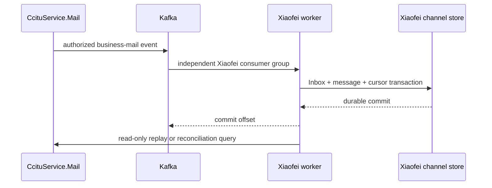
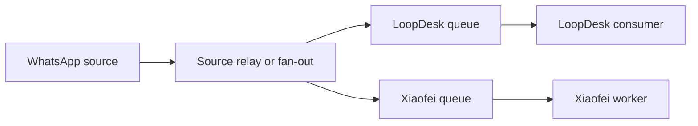

# Flyranking and LoopDesk integration direction

This is a target-integration design, not an implementation record. It turns a
2026-07-26 read-only review of 31 Flyranking GitLab repositories into bounded,
reviewable direction for Xiaofei. It does not establish production topology,
credentials, tenant mappings, or service ownership.

For implemented Xiaofei behavior, use [the domain foundation](./xiaofei-foundation.md),
[the P0 framework](./xiaofei-p0-framework.md), and the package READMEs as the
canonical sources. The target control-plane view is in
[Xiaofei target architecture](./xiaofei-loopdesk-target-architecture.md).

## Evidence labels

- **Observed — 2026-07-26 legacy-code snapshot:** a repository-level observation;
  it is not a claim about a running environment.
- **Proposed target:** a design decision that needs its own implementation issue
  and review.
- **Operations/product confirmation required:** an unknown that must be resolved
  before implementation or rollout.

## Current P0 boundary

**Implemented today:** `channel:public-support` is a single-channel validation
adapter using `/support`, `/inbox`, and short polling. The kernel has local
owner/lease and final Guardrail decisions. Knowledge supports local MD/TXT
parsing, server-side Firecrawl parsing for PDF/DOCX/XLSX and one public web
page, plus provider-independent Manual Q&A; normalized entries become KU drafts
that are reviewed, published or revoked before Capability review and matching
version deterministic Eval.

**Not implemented today:** real Flyranking channel bindings, source consumers,
durable external-message Inbox/Cursor/Receipt/Outbox, `ReplyIntent`, LoopDesk
S2S APIs, or a distributed send-time fencing check. Do not infer those target
objects from the P0 JSON snapshots.

## Snapshot observations and proposed integration

| Area                   | Observed — 2026-07-26 legacy-code snapshot                                                                         | Proposed target                                                                                                                                                              |
| ---------------------- | ------------------------------------------------------------------------------------------------------------------ | ---------------------------------------------------------------------------------------------------------------------------------------------------------------------------- |
| Email                  | `CcituService.Mail` connects mail providers, persists mail and attachments, and emits Kafka notifications.         | Xiaofei uses its own Kafka consumer group and a read-only replay/reconciliation API; it never shares LoopDesk’s group.                                                       |
| WhatsApp               | `CCITU.Tools.WhatsApp` publishes to `CRMWhatsAppMsg`, which is a competing-consumer work queue used by LoopDesk.   | The source adds a fan-out exchange or relay; LoopDesk and Xiaofei receive separate queues. Xiaofei never consumes `CRMWhatsAppMsg`.                                          |
| Operator and send path | `ccitucrm` / LoopDesk owns sessions, agent collaboration, existing channel sending, and customer-visible records.  | LoopDesk remains the only customer-visible send gateway and exposes a versioned S2S integration API plus one channel Reply Dispatcher.                                       |
| Xiaofei                | The current repository owns vendor-neutral decisions, Guardrail, local owner lease, knowledge and trace contracts. | Xiaofei gains separately owned channel Binding, normalized message, conversation projection, decision, command Outbox, receipt Inbox, trace, and AI/Human owner projections. |

### Email ingestion

The observed notification stream may already apply source-side filtering. Its
completeness metric must therefore mean authorized, customer-service-domain
messages unless a separately authorized pre-filter source outbox is added.

### WhatsApp ingestion

The existing `CRMWhatsAppMsg` queue is not broadcast infrastructure. Adding a
Xiaofei consumer would take messages away from LoopDesk and is prohibited.

## Ownership, fencing, and reliable delivery

Xiaofei and LoopDesk have different authoritative facts. They must not share
one Inbox, Outbox, or Receipt table.

| System   | Authoritative responsibility                                            | Reliability object                                     |
| -------- | ----------------------------------------------------------------------- | ------------------------------------------------------ |
| Xiaofei  | local AI owner epoch, lease, decision, Guardrail result, `ReplyIntent`  | command Outbox and receipt-owner Inbox                 |
| LoopDesk | human takeover/transfer/close, local send permit, customer-visible send | reply idempotency store and receipt-owner event Outbox |

On a human takeover, transfer, or close, LoopDesk must atomically increment its
local `loopOwnerVersion` (a fencing token) in the same transaction that blocks
sending, then publish an owner event. Xiaofei consumes that event to advance its
local `ownerEpoch`, invalidating in-flight AI leases. A reply command contains
both `expectedOwnerEpoch` and `expectedLoopOwnerVersion`; LoopDesk verifies its
own authoritative version immediately before provider delivery. The local epoch
is essential but is not sufficient during asynchronous event propagation.

### Versioned contracts to freeze before implementation

| Contract              | Minimum purpose                                                                                                          |
| --------------------- | ------------------------------------------------------------------------------------------------------------------------ |
| `ChannelEnvelope v1`  | source/event identity, channel/account, direction, content references, ordering and schema version                       |
| `LoopReplyCommand v1` | idempotency key, decision/trace IDs, mappings, reply content, expected Xiaofei epoch and expected LoopDesk owner version |
| `LoopOwnerEvent v1`   | event ID, owner action, loop session/conversation mapping, monotonic `loopOwnerVersion`, timestamp and reason            |
| `ReplyReceipt v1`     | accepted, sent, failed, or blocked result with stable reason and provider reference when available                       |

The LoopDesk dispatcher checks S2S authentication, replay protection, mapping,
idempotency, enabled mode, session status, local owner version, channel policy,
and then repeats the local owner check just before calling the provider. A
blocked or failed send is a receipt, not an invitation to retry blindly.

## Target Xiaofei data model

These are proposed persistent records, not a request to change the current
schema in this documentation issue.

| Record                                       | Purpose and idempotency boundary                               |
| -------------------------------------------- | -------------------------------------------------------------- |
| `TenantChannelBinding`                       | company/workspace/channel/account mapping                      |
| `ChannelCursor` and `IngestionInbox`         | source progress and `source + eventId` de-duplication          |
| `ExternalConversation` and `ExternalMessage` | normalized channel projection and external IDs                 |
| `OwnershipProjection`                        | most recent accepted LoopDesk version and local owner relation |
| `Decision`, `ReplyIntent`, `ReplyAttempt`    | immutable decision, authorized command, and idempotency key    |
| command Outbox / receipt Inbox / dead letter | independent at-least-once delivery and recovery                |

An inbound worker first commits Inbox, normalized message, and cursor; only
then does it acknowledge the broker. It schedules AI work after the transaction
and never holds a broker delivery open while a model runs. `ReplyIntent` and
the Xiaofei command Outbox are written in one transaction after final Guardrail
and lease reauthorization.

## Legacy repository impact map

This compressed map preserves the scope of the 31-repository snapshot without
embedding local paths, branches, accounts, or operational state.

| Repositories                                                                                                                                                                                                                                       | Impact                                                                                 |
| -------------------------------------------------------------------------------------------------------------------------------------------------------------------------------------------------------------------------------------------------- | -------------------------------------------------------------------------------------- |
| `ccitucrm`, `ccitucrmweb`                                                                                                                                                                                                                          | highest: LoopDesk API, dispatcher, owner events, operator UI                           |
| `CcituService.Mail`, `CCITU.Tools.WhatsApp`                                                                                                                                                                                                        | highest: Email source and WhatsApp fan-out/relay                                       |
| `ccituchatai`, `ccituchataiweb`, `chataiservice`                                                                                                                                                                                                   | high: legacy AI shadow, rollback, then retirement                                      |
| `CcituIoE`, `CcituIoEWeb`, `CcituService.OSS`                                                                                                                                                                                                      | medium: tenant/navigation candidates and controlled attachment references              |
| `CcituCDP`, `CDP-SDK`, `CcituSCRM`, `CcituSCRMWeb`, `CcituService.Facebook`, `CcituService.Translate`                                                                                                                                              | later: optional context, social channels, or tools                                     |
| `CcituEDM`, `CcituEDMWeb`, `CCITU.Common`, `CCITU.AuthCore`                                                                                                                                                                                        | limited: avoid confusing marketing mail, shared DTO, or old auth with the new boundary |
| `CcituService.FileExporter`, `CcituService.Transparency`, `CcituService.Go-Admin`, `CCITU.Web.Common`, `FLSY.Web.Common`, `CCITU.ProjectTemplate`, `CCITU.CoSenser.OTA`, `CCITU.ZiNiao.Plugin`, `CcituCosenserApp`, `CcituTapmeApp`, `CcituPetApp` | no direct first-phase change identified                                                |

## Migration and acceptance

1. **Mirror:** persist and reconcile source messages; no model or send.
2. **Shadow:** generate decisions and candidates; no customer-visible output.
3. **Assist:** LoopDesk presents suggestions; a human sends through normal LoopDesk flow.
4. **Limited auto:** small, low-risk, reviewed scopes with kill switches and active monitoring.
5. **Cutover:** make the target path default only after the legacy automatic responder is disabled for the same scope.

At every stage, a conversation has exactly one automatic-reply owner: legacy,
Xiaofei, or none. A migration mode is enforced at the send gateway, not merely
in a UI flag.

Acceptance cases include duplicate source delivery producing one normalized
message; Xiaofei startup not reducing LoopDesk delivery; replay/live overlap
remaining idempotent; missing binding never entering AI; takeover after model
start or command enqueue blocking delivery; stale owner events rejected by
monotonic LoopDesk version; and customer send receipts reconciling to provider
outcomes.

## Required confirmations and follow-up boundaries

Before code work, operations and product must confirm the production source
topology, Kafka ACLs/topic names, RabbitMQ exchange/queue/DLQ permissions,
WhatsApp gateway variants, tenant/channel-account authority, cross-channel
session semantics, retention/data-region requirements, deployment runtime, and
the meaning of takeover/transfer/close.

Split implementation ownership by contract, Xiaofei persistence, worker shell,
Email connector, WhatsApp fan-out, LoopDesk API/dispatcher/owner outbox, runtime
wiring, UI, migration controls, and legacy retirement. None of those changes is
made by this document.
