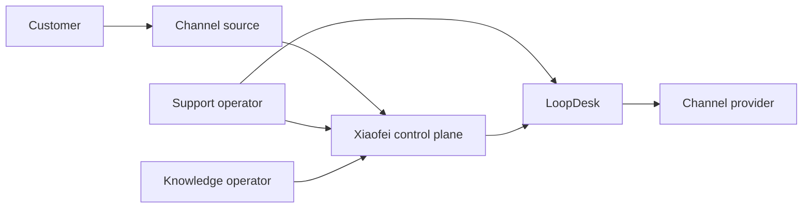
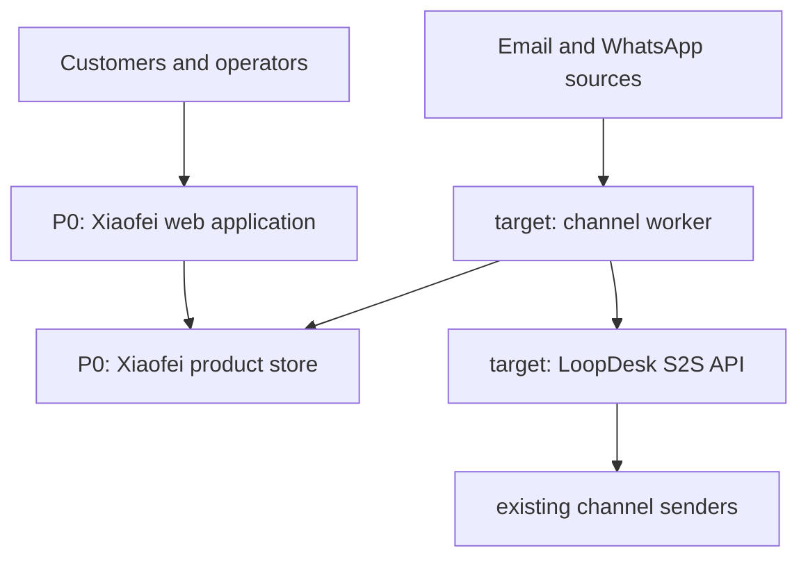
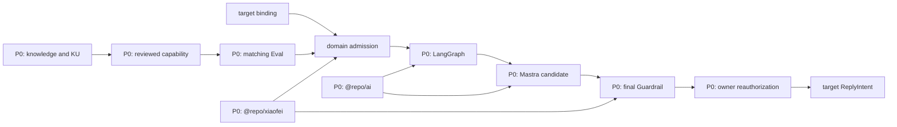
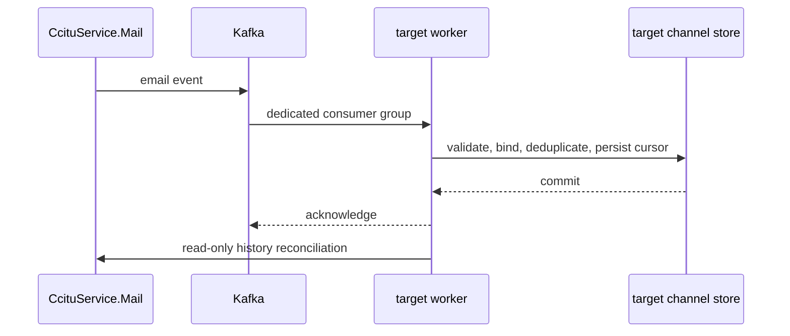
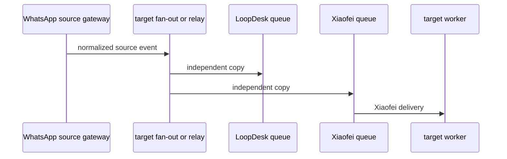
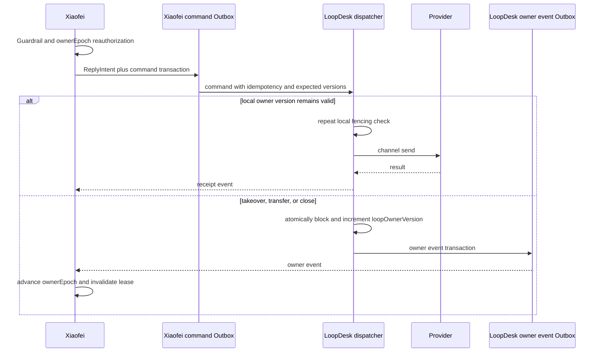
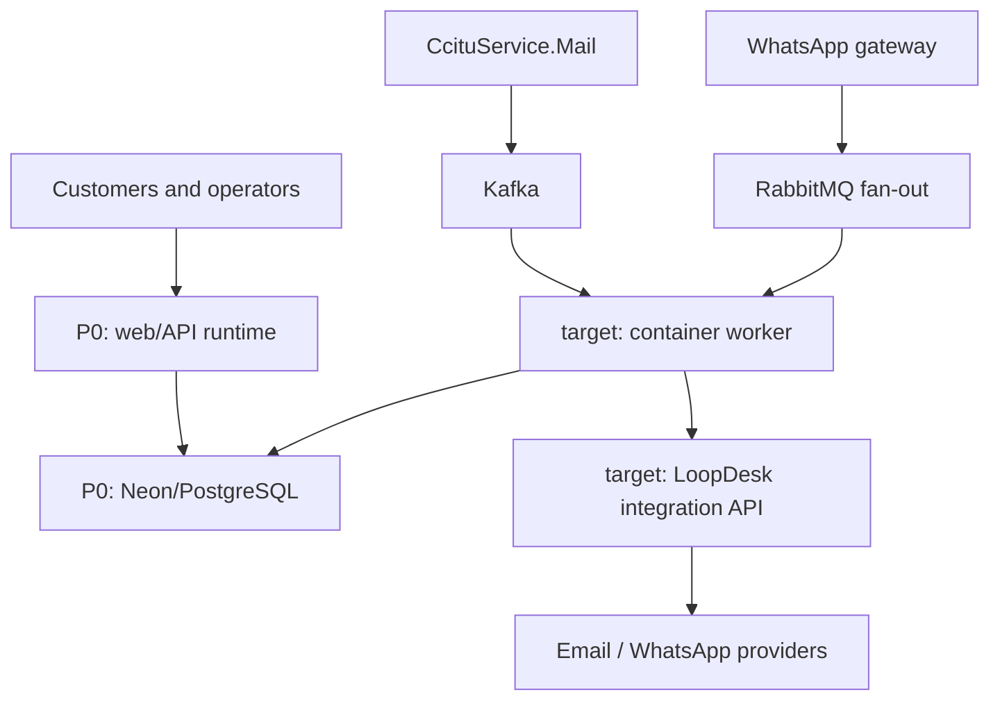
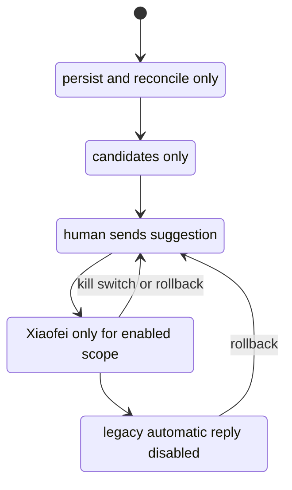

# Xiaofei target architecture

Xiaofei is a governed customer-service Agent control plane. It is not a channel
adapter and it is not a model that receives send authority by producing text.
This document shows the proposed architecture around the implemented P0 and the
Flyranking/LoopDesk target integration. For canonical current behavior, follow
[the foundation](./xiaofei-foundation.md), [the P0 framework](./xiaofei-p0-framework.md),
[`@repo/xiaofei`](../packages/xiaofei/README.md), and
[`@repo/ai`](../packages/ai/README.md).

**Legend:** solid nodes named “P0” are implemented boundaries; nodes marked
“target” require future delivery. Arrows represent dependency or event direction,
not permission to write another system’s database.

## Non-negotiable send gate

`@repo/xiaofei` remains the vendor-neutral domain kernel. LangGraph is the sole
conversation-state orchestrator; Mastra and a model generate only a constrained
candidate. Knowledge eligibility, reviewed Capability, same-version passing
Eval, final Guardrail, and owner reauthorization fail closed. A candidate is
never customer-visible authorization. The target external integration adds
LoopDesk’s authoritative send-time fencing; see
[the integration design](./xiaofei-loopdesk-integration-plan.md).

## 1. System context

Xiaofei decides whether a reply may be proposed and authorized; LoopDesk owns
human collaboration and the final channel delivery; channel sources own source
events. No system directly writes another system’s private data.

## 2. Container view

These are deployable/runtime and data-store boundaries only. The worker is a
target always-on runtime; Vercel-style request handlers must not hold Kafka or
RabbitMQ consumer connections. Package-level dependency direction appears only
in the component view below.

## 3. Xiaofei brain component view

Only the domain’s finalization path can create a target `ReplyIntent`; neither
the model nor a channel adapter may skip the gate.

## 4. Email inbound view

The dedicated group prevents competition with LoopDesk. Actual topic names,
ACLs, and completeness semantics remain operations confirmations.

## 5. WhatsApp inbound view

`CRMWhatsAppMsg` is an observed competing-consumer queue, so it is never the
Xiaofei input. Replay capability and the real gateway topology are unresolved.

## 6. Reply, receipt, and human takeover

LoopDesk’s `loopOwnerVersion` is the final distributed fence. Xiaofei’s
`ownerEpoch` protects its AI lease but cannot close the asynchronous propagation
window by itself. Receipts belong to LoopDesk’s event outbox until Xiaofei
durably consumes them; each side owns its own reliability records.

## 7. Deployment view

Each environment isolates broker credentials, data, queues, groups, and S2S
clients. Deployment platform, networking, retention, and observability controls
are target operational decisions, not documented as completed infrastructure.

## 8. Migration and automatic-reply owner

For every company/channel/conversation scope, the automatic-reply owner is one
of `none`, `legacy`, or `Xiaofei`; it is never both. Mirror, shadow, and assist
have no Xiaofei customer-visible automatic send.

## Target boundaries to implement separately

The next work should be independently owned: versioned channel/receipt/owner
contracts; persistence for binding, cursors, messages, outbox and receipt inbox;
worker runtime; Email connector; WhatsApp fan-out; LoopDesk S2S API and unified
dispatcher; owner event outbox; UI projections; migration controls; and legacy
retirement. See the integration document for acceptance cases and production
questions. This documentation adds no code, deployment, authorization change,
or cloud resource.
